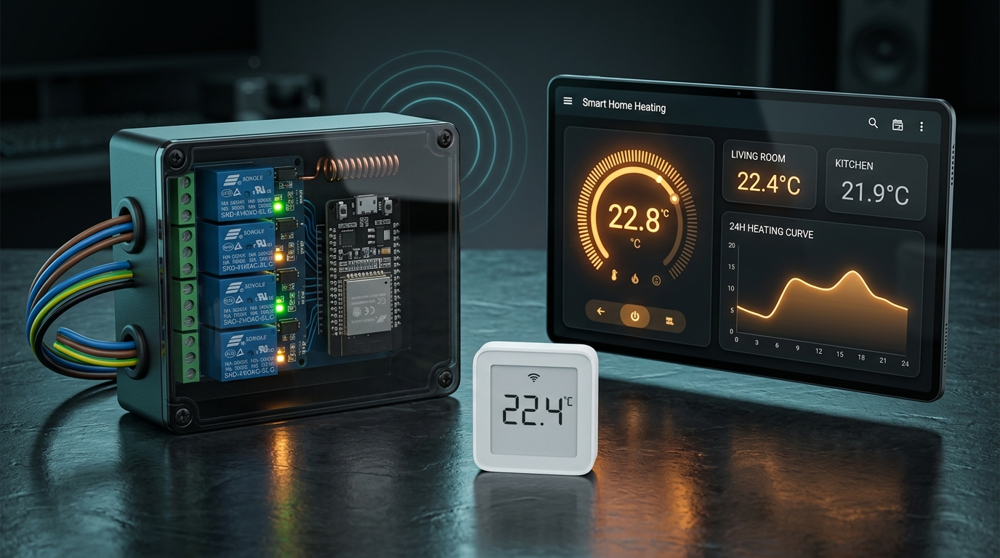

<div align="center">

# 🔥 Smart Home Heating

<p align="center">
  
</p>

<p align="center">
  <b>⚡ Autonomous multi-zone underfloor heating controller — install once, calibrate once, forget it.</b><br/>
  <i>Engineered for the heavy thermal inertia of concrete screed floors. Perfect comfort with zero cloud dependencies.</i>
</p>

<!-- Clean, User-Friendly Badges -->
<p align="center">
  <a href="LICENSE"></a>
  
  
  
  
  
</p>

<!-- Quick Navigation Bar -->
<p align="center">
  <a href="#-key-benefits">🌟 <b>Benefits</b></a> •
  <a href="#-the-live-dashboard">📱 <b>Live UI</b></a> •
  <a href="#-how-it-works">💡 <b>How It Works</b></a> •
  <a href="#-quick-start">🚀 <b>Quick Start</b></a> •
  <a href="#%EF%B8%8F-technical-specifications">🛠️ <b>Tech Specs</b></a> •
  <a href="#-rest-api--cli">🔌 <b>API & CLI</b></a> •
  <a href="#-safety--failsafes">🔒 <b>Safety</b></a> •
  <a href="#-docs">📄 <b>Docs</b></a>
</p>

<br/>

<!-- Hero Presentation Showcase -->
<p align="center">
  
</p>

<br/>

</div>

---

## 🌟 Key Benefits

<table>
  <tr>
    <td width="50%" valign="top">
      <b>🛡️ 100% Local & Cloud-Free</b><br/>
      Runs completely on your local network. <b>No cloud accounts</b>, no third-party servers, and no monthly subscriptions. If your internet goes down, your heating keeps working without interruption.
    </td>
    <td width="50%" valign="top">
      <b>🌡️ Rock-Solid ±0.3 °C Comfort</b><br/>
      Underfloor heating is slow to warm up and slow to cool down. Traditional thermostats cause severe temperature swings. Our pulsed screed algorithm eliminates overheating and cold spots automatically.
    </td>
  </tr>
  <tr>
    <td width="50%" valign="top">
      <b>🌤️ Smart Weather Pre-Heat</b><br/>
      Checks local outdoor temperatures automatically. On freezing winter mornings, it starts warming the slab earlier so your rooms are at the exact target temperature when you wake up.
    </td>
    <td width="50%" valign="top">
      <b>📡 Zero-Wire Room Sensors</b><br/>
      Listens passively to affordable Xiaomi BLE thermometers placed in each room. <b>No wires across walls</b>, no pairing procedures, and batteries last up to 2 years.
    </td>
  </tr>
  <tr>
    <td width="50%" valign="top">
      <b>🔥 Wireless Boiler Control</b><br/>
      Triggers your gas boiler wirelessly using a 433.92 MHz radio signal. <b>No drilling walls or pulling cables</b> between your heating manifold and the boiler.
    </td>
    <td width="50%" valign="top">
      <b>🔒 Industrial-Grade Safety Guards</b><br/>
      Built-in hardware interlocks: delays boiler ignition until valves physically open, prevents burner wear, runs pump overrun, and protects against frozen pipes (&lt;12 °C).
    </td>
  </tr>
</table>

---

## 📱 The Live Dashboard

The web interface is hosted directly on the ESP32 chip. It loads instantly in any browser on phone, tablet, or PC without needing an app store download or internet connection.

<p align="center">
  
</p>

### What You Get:
- **Interactive Temperature Dials:** Tap `+` or `-` to temporarily boost room warmth — resets automatically at the next schedule slot.
- **5 Sleek Themes:** Switch between *Smartiva Glass*, *HA Charcoal*, *Glass Glow*, *Smartiva Dark*, and *Nordic Light*.
- **24-Hour Telemetry Curves:** Live charts show room temperatures, outdoor weather trends, and valve activity.
- **Gas & Cost Estimation:** Displays live burner status, daily running hours, and calculates estimated gas consumption and cost.
- **One-Touch Away Mode:** Drop all rooms to energy-saving temperatures with a single tap when leaving the house.

---

## 💡 How It Works

Underfloor hydronic heating requires a different approach than fast radiators. Because concrete absorbs heat slowly and releases it over hours, ordinary ON/OFF thermostats constantly overshoot.

```text
  Xiaomi BLE Sensors                  ESP32 4-Relay Controller              Floor Manifold & Boiler
 ┌───────────────────┐              ┌──────────────────────────┐          ┌──────────────────────────┐
 │  Living Room 23°  │──(Wireless)─►│                          │──Relays─►│ 230V Thermal Actuators   │
 │  Kids Room   22°  │   Bluetooth  │  TPI Pulse Modulation    │          │ (Opens circuits in slab) │
 │  Bedroom     21°  │              │  + Weather Pre-Heat      │          └──────────────────────────┘
 └───────────────────┘              │                          │                    │
 ┌───────────────────┐              │                          │──(433 MHz)────────►│ Gas Boiler (Ignition)    │
 │ Open-Meteo API    │───(Wi-Fi)───►│                          │   Radio Link       └──────────────────────────┘
 └───────────────────┘              └──────────────────────────┘
```

1. **Schedule What You Need:** Set target temperatures for **Day**, **Night**, and **Away** (e.g. `06:30=Day (23 °C)`, `22:30=Night (21 °C)`).
2. **Weather Anticipation:** If it's +5 °C outside, heating starts 2 hours early; if it's −5 °C, it starts 3.5 hours early.
3. **Pulsed Valve Cycles:** Every hour, each zone opens its manifold valve for the exact duration required to hold the target temperature within ±0.3 °C.

---

## 🚀 Quick Start

### 1. Configure Wi-Fi (`include/secrets.h`)
Create an untracked `include/secrets.h` file:

```c
#pragma once
#define DEFAULT_WIFI_SSID "Your_WiFi_Name"
#define DEFAULT_WIFI_PASS "Your_WiFi_Password"
#define OTA_USER          "admin"
#define OTA_PASS          "Your_Admin_Password"
```

### 2. Build & Flash (First Time USB)
```bash
# Compile and flash via PlatformIO
pio run -e esp32dev --target upload
```

### 3. Future Updates (100% Wireless OTA)
Once flashed, you never need USB cables again:
```bash
# Compile and stream firmware over Wi-Fi
pio run -e esp32dev
python tools/sh_ota_upload.py
```
*(Or navigate to `http://192.168.1.20/update` in your browser).*

---

<details>
<summary>🛠️ <b>Click here for Technical Specifications & Hardware Pinout</b></summary>

<br/>

### Hardware Architecture (Reference Installation)

| Component | Hardware Details | Function |
|---|---|---|
| **MCU Board** | ESP32-Relay X4 V1.1 (ESP32-WROOM-32E, 240 MHz, 4 MB Flash) | Core controller & web server (`192.168.1.20`) |
| **Relay 1** | `GPIO32` (230V NC Actuators) | **Zone 1:** Living Room + Kitchen + Hallway (3 loops) |
| **Relay 2** | `GPIO33` (230V NC Actuators) | **Zone 2:** Children's Bedroom (2 loops) |
| **Relay 3** | `GPIO25` (230V NC Actuators) | **Zone 3:** Master Bedroom (2 loops) |
| **Relay 4** | `GPIO26` (Dry Contact) | Auxiliary pump / GPA circuit (spare) |
| **RF Transmitter** | `GPIO19` (433.92 MHz OOK) | Wireless boiler trigger (replaces wall thermostat) |
| **Status LED** | `GPIO23` (Active LOW) | System status & communication pulses |
| **Sensors** | Xiaomi LYWSD03MMC (BLE) | Passive broadcast scan (PVVX / BTHome V2 firmware) |
| **Boiler** | Immergas Victrix Tera 24 | Condensing gas boiler with dry contact remote receiver |

</details>

---

<details>
<summary>🔌 <b>Click here for REST API & CLI Tool Reference</b></summary>

<br/>

### Companion Python CLI (`tools/sh_esp_cli.py`)
```bash
# View live status and room temperatures
python tools/sh_esp_cli.py status

# Set Zone 1 target temperature to 22.5 °C
python tools/sh_esp_cli.py zone 1 target 22.5

# Toggle Away mode
python tools/sh_esp_cli.py away on
python tools/sh_esp_cli.py away off

# Check diagnostics and event logs
python tools/sh_esp_cli.py diag
```

### Core REST API Endpoints

| Endpoint | Method | Purpose |
|---|---|---|
| `/api/status` | `GET` | Complete controller status: boiler, flame, outdoor temp, and all zone values |
| `/api/zones` | `GET`, `POST` | Read current room temperatures or set temporary target boosts |
| `/api/schedule` | `GET`, `POST` | Inspect or update day/night time slot boundaries |
| `/api/history` | `GET` | 24-hour historical temperature and weather data |
| `/api/diag` | `GET` | Active diagnostic trouble codes (DTCs) and sensor RSSI levels |

*An interactive Telnet console is also available on port 23 (`telnet 192.168.1.20 23`).*

</details>

---

<details>
<summary>🔒 <b>Click here for Safety Invariants & Failsafes</b></summary>

<br/>

Heating systems must guarantee absolute physical protection against equipment failure:

- **Actuator Delay Interlock (FR-2):** Delays boiler ignition (~180s) until thermal actuators have physically expanded and opened, preventing circulation pumps from dead-heading against closed valves.
- **Overrun Heat Dissipation (FR-3):** Keeps the last open circuit open during boiler operation and for an overrun duration afterward to safely dissipate heat exchanger thermal mass.
- **Burner Anti-Short-Cycling (FR-4):** Enforces mandatory minimum runtimes and cooldown pauses to protect boiler components from rapid on/off fatigue.
- **Automatic Frost Protection (FR-16):** If any room temperature drops below 12.0 °C, valves and boiler fire immediately, regardless of Away mode or schedules.
- **Sensor Loss Safeguard (FR-51):** If a wireless room thermometer fails to report, the zone switches to a safe fallback duty cycle and flags `DTC-101` rather than shutting down.
- **Safe Boot State (NFR-1.4):** Upon boot, all relays stay OFF, a boiler OFF pulse is broadcast, and sensor calibration completes before any heat command is issued.

</details>

---

## 📄 Documentation & Links

- **[System Architecture](docs/architecture.md)** — In-depth software architecture, memory maps, and TPI control loop maths.
- **[Requirements & Specifications](docs/requirements_and_features.md)** — Functional specifications and safety rules.
- **[REST API Reference](docs/api_reference.md)** — Complete JSON endpoint documentation.
- **[Hardware & Wiring Guide](docs/hardware_esp32_relay.md)** — Board pinout, electrical schematic, and wiring.
- **[Hydraulics & Failsafes](docs/underfloor_heating_hydraulics_and_failsafes.md)** — Plumbing guidelines and bypass loops.
- **[Project Plan](docs/plan.md)** & **[Changelog](docs/changelog.md)** — Migration steps and verification records.

---

## 📜 License & Credits

- **Software & Firmware:** [MIT License](LICENSE). Developed by [Bogdan Seceleanu](https://github.com/RoDTOX) with Google DeepMind Antigravity.
- **Reference Hardware:** ESP32-Relay X4 V1.1 / Espressif Systems.
- **Sensors:** Xiaomi Mijia BLE (PVVX / BTHome open-source firmware).
