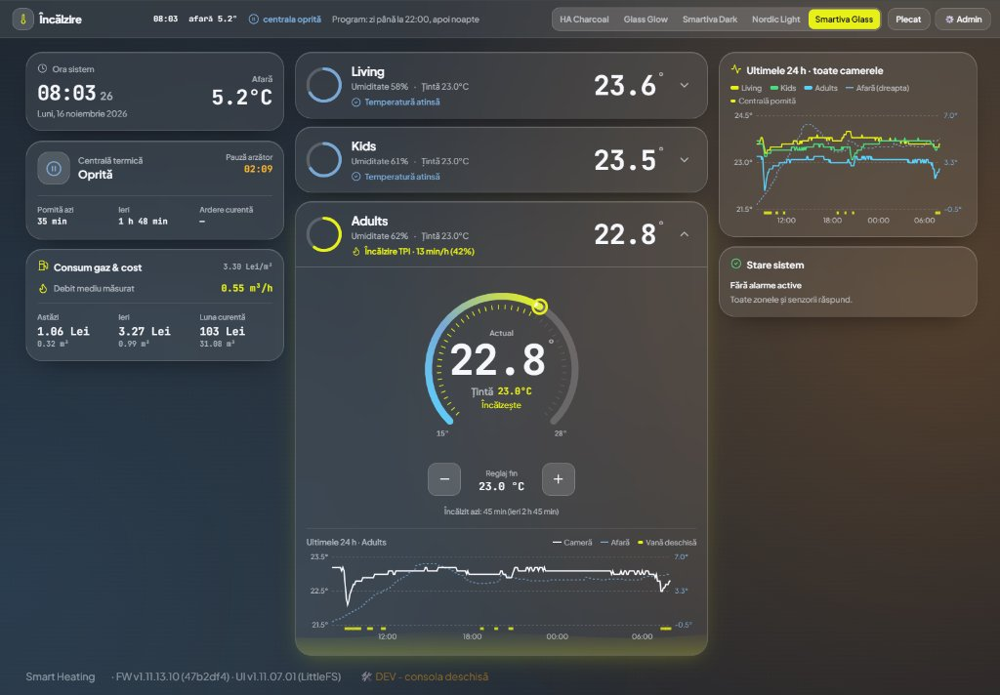

<div align="center">

# 🔥 Smart Home Heating

<p align="center">
  
</p>

<p align="center">
  <b>⚡ Autonomous climate control for hydronic underfloor heating — install once, calibrate once, forget it.</b><br/>
  <i>Precision screed pulse modulation engineered for high thermal mass. 100% local operation with zero cloud dependencies.</i>
</p>

<!-- Project Status & Specs -->
<p align="center">
  <a href="LICENSE"></a>
  
  
  
  
  
</p>

<!-- Quick Navigation Bar -->
<p align="center">
  <a href="#-key-benefits">🌟 <b>Benefits</b></a> •
  <a href="#-the-live-dashboard">📱 <b>Live UI</b></a> •
  <a href="#-how-it-works">💡 <b>How It Works</b></a> •
  <a href="#-quick-start">🚀 <b>Quick Start</b></a> •
  <a href="#-technical-specifications">🛠️ <b>Tech Specs</b></a> •
  <a href="#-rest-api--cli">🔌 <b>API & CLI</b></a> •
  <a href="#-safety--failsafes">🔒 <b>Safety</b></a> •
  <a href="#-documentation--links">📄 <b>Docs</b></a>
</p>

<br/>

<!-- Hero Presentation Showcase -->
<p align="center">
  
</p>

</div>

---

## 🌟 Key Benefits

<table>
  <tr>
    <td width="50%" valign="top">
      <b>🛡️ 100% Local & Cloud-Free</b><br/>
      Runs entirely within your home network. <b>No cloud accounts</b>, no third-party tracking, and zero subscriptions. If your internet connection goes down, your heating continues running flawlessly.
    </td>
    <td width="50%" valign="top">
      <b>🌡️ Rock-Solid ±0.3 °C Comfort</b><br/>
      Underfloor heating holds massive thermal inertia. Standard on/off thermostats constantly overshoot. Our time-proportional pulse algorithm eliminates hot flashes and cold floors automatically.
    </td>
  </tr>
  <tr>
    <td width="50%" valign="top">
      <b>🌤️ Predictive Weather Adaptation</b><br/>
      Checks local outdoor temperature via Open-Meteo. On cold winter mornings, it starts heating earlier (e.g. 2h earlier at +5 °C, 3.5h earlier at −5 °C) so rooms reach target temperature right on time.
    </td>
    <td width="50%" valign="top">
      <b>📡 Zero-Wire Room Thermometers</b><br/>
      Listens passively to inexpensive Xiaomi BLE temperature sensors in each room. <b>No wall drilling</b>, no pairing steps, and sensor batteries last up to 2 years.
    </td>
  </tr>
  <tr>
    <td width="50%" valign="top">
      <b>🔥 Wireless Boiler Actuation</b><br/>
      Controls the gas boiler wirelessly over 433.92 MHz radio pulses. <b>No running cables</b> between the underfloor heating manifold and the boiler unit.
    </td>
    <td width="50%" valign="top">
      <b>🔒 Built-in Hydraulic Failsafes</b><br/>
      Embedded protection rules: valve opening delay before ignition, burner anti-short-cycling guard, pump overrun heat dissipation, and automatic frost prevention (&lt;12 °C).
    </td>
  </tr>
</table>

---

## 📱 The Live Dashboard

Hosted entirely inside the ESP32 Flash memory (LittleFS), the single-page web dashboard loads in milliseconds on any mobile phone, tablet, or desktop browser.

<p align="center">
  
</p>

### Dashboard Features
- **Intuitive Touch Controls:** Radial thermostat dial with single-tap `+` / `-` boost trims that automatically expire at the next schedule slot.
- **5 Built-in Themes:** Choose between *Smartiva Glass* (default dark glassmorphism), *HA Charcoal*, *Glass Glow*, *Smartiva Dark*, and *Nordic Light*.
- **24-Hour Telemetry Curves:** Live charts display individual room temperatures, outdoor weather, and valve open times.
- **Gas & Energy Telemetry:** Monitors burner runtime, pause intervals, and calculates estimated gas consumption and cost.
- **One-Touch Away Mode:** Immediately drops all zones to an energy-saving setback temperature when leaving home.

---

## 💡 How It Works

```text
 ┌──────────────────────┐             ┌──────────────────────────┐          ┌──────────────────────────┐
 │  Xiaomi BLE Sensors  │──(Wireless)►│   ESP32-Relay X4 Unit    │──Relays─►│ 230V Thermal Actuators   │
 │  (Living, Kids, Bed) │  Bluetooth  │                          │          │ (Underfloor Manifold)    │
 └──────────────────────┘             │  • TPI Screed Pulse Loop │          └──────────────────────────┘
 ┌──────────────────────┐             │  • Weather Anticipation  │                       │
 │  Open-Meteo Weather  │──(Internet)►│  • Hydraulic Failsafes   │──(433 MHz)───────────►│ Gas Boiler (Ignition)    │
 │  (Outdoor Temp API)  │   Optional  └──────────────────────────┘   Radio Trigger       └──────────────────────────┘
```

1. **Set Desired Schedules:** Assign temperatures for **Day**, **Night**, and **Away** modes with custom time slots.
2. **Weather Adjustment:** The controller anticipates screed warm-up time by factoring in outdoor temperature.
3. **Pulsed Valve Cycles:** Each hour, manifold loops open for a calculated duty cycle (`error / 1.5 °C + learned base duty`) to keep room air stable within ±0.3 °C.

---

## 🚀 Quick Start

### 1. Configure Network Credentials (`include/secrets.h`)
Create an untracked `include/secrets.h` file:

```c
#pragma once
#define DEFAULT_WIFI_SSID "Your_WiFi_SSID"
#define DEFAULT_WIFI_PASS "Your_WiFi_Password"
#define OTA_USER          "admin"
#define OTA_PASS          "Your_Admin_Password"
```

### 2. First-Time USB Flash
```bash
# Compile and flash via PlatformIO
pio run -e esp32dev --target upload
```

### 3. Wireless OTA Updates
Once installed, update firmware or web assets over Wi-Fi without touching the controller:
```bash
# Upload firmware over the local network
python tools/sh_ota_upload.py

# Upload web assets (dashboard SPA)
python tools/sh_ota_upload.py assets
```
*(Or open `http://<controller-ip>/update` in your browser).*

---

<details id="technical-specifications">
<summary>🛠️ <b>Click here for Technical Specifications & Pinout</b></summary>

<br/>

### Hardware Configuration (Reference Installation)

| Component | Hardware Identifier | Role & Assignment |
|---|---|---|
| **Controller MCU** | ESP32-Relay X4 V1.1 (ESP32-WROOM-32E, 240 MHz Dual-Core, 4 MB Flash) | System controller and embedded web server |
| **Relay 1** | `GPIO32` (230V NC Actuators) | **Zone 1:** Living Room + Kitchen + Hallway (3 loops) |
| **Relay 2** | `GPIO33` (230V NC Actuators) | **Zone 2:** Children's Bedroom (2 loops) |
| **Relay 3** | `GPIO25` (230V NC Actuators) | **Zone 3:** Master Bedroom (2 loops) |
| **Relay 4** | `GPIO26` (Dry Contact) | Auxiliary circulation pump / Spare circuit |
| **Radio Transmitter** | `GPIO19` (433.92 MHz OOK) | Wireless burner command transmission |
| **Status LED** | `GPIO23` (Active LOW) | Visual heartbeat and communication activity |
| **Room Thermometers** | Xiaomi LYWSD03MMC | BLE passive advertisement scan (PVVX / BTHome V2) |
| **Gas Boiler** | Immergas Victrix Tera 24 | Condensing boiler toggled via 433 MHz wireless receiver |

</details>

---

<details id="rest-api--cli">
<summary>🔌 <b>Click here for REST API & CLI Tool Reference</b></summary>

<br/>

### Python Management CLI (`tools/sh_esp_cli.py`)
```bash
# View live status and room temperatures
python tools/sh_esp_cli.py status

# Set Zone 1 target temperature to 22.5 °C
python tools/sh_esp_cli.py zone 1 target 22.5

# Toggle global Away mode
python tools/sh_esp_cli.py away on
python tools/sh_esp_cli.py away off

# Inspect system diagnostics and event logs
python tools/sh_esp_cli.py diag
```

### Key REST API Endpoints

| Endpoint | Method | Description |
|---|---|---|
| `/api/status` | `GET` | System state: boiler status, flame, outdoor temp, and zone telemetry |
| `/api/zones` | `GET`, `POST` | Inspect all zones or apply target setpoints and boost trims |
| `/api/schedule` | `GET`, `POST` | Read or update weekday/weekend schedule boundaries |
| `/api/history` | `GET` | 24-hour historical temperature and weather curves |
| `/api/diag` | `GET` | Active diagnostic trouble codes and sensor signal strength |
| `/api/diag/events` | `GET`, `POST` | Retrieve persistent event history or clear event log |

*Telnet console access is also available on port 23 (`telnet <controller-ip> 23`).*

</details>

---

<details id="safety--failsafes">
<summary>🔒 <b>Click here for Safety Invariants & Hydraulic Failsafes</b></summary>

<br/>

Heating systems must guarantee absolute physical protection against equipment damage:

- **Actuator Delay Interlock:** Delays boiler ignition (~180s) until thermal actuators have physically opened, preventing circulation pumps from dead-heading against closed valves.
- **Overrun Heat Dissipation:** Keeps the last open valve open during firing and for a cooldown period after burner shutdown to dissipate residual heat.
- **Burner Anti-Short-Cycling:** Enforces minimum burn times and cooldown pauses to protect boiler components from rapid on/off fatigue.
- **Automatic Frost Protection:** If any room drops below 12.0 °C, the circuit and boiler engage immediately, regardless of Away mode or schedules.
- **Sensor Loss Fallback:** If a wireless thermometer stops transmitting, the zone switches to a safe baseline duty cycle rather than freezing or overheating.
- **Safe Boot State:** Boots with all relays open, transmits an immediate boiler OFF signal, and completes sensor warm-up before any heating command is issued.

</details>

---

## 📄 Documentation & Links

- **[System Architecture](docs/architecture.md)** — Detailed software architecture, memory maps, and TPI control loop maths.
- **[Requirements & Specifications](docs/requirements_and_features.md)** — Functional requirements catalog and safety rules.
- **[REST API Reference](docs/api_reference.md)** — Complete JSON endpoint documentation.
- **[Hardware & Wiring Guide](docs/hardware_esp32_relay.md)** — Board pinout, electrical schematic, and wiring.
- **[Hydraulics & Failsafes](docs/underfloor_heating_hydraulics_and_failsafes.md)** — Plumbing guidelines and bypass loops.
- **[Project Plan](docs/plan.md)** & **[Changelog](docs/changelog.md)** — Roadmap and revision records.

---

## 📜 License & Credits

- **Software & Firmware:** [MIT License](LICENSE). Developed by [Bogdan Seceleanu](https://github.com/RoDTOX) with Google DeepMind Antigravity.
- **Reference Hardware:** ESP32-Relay X4 V1.1 / Espressif Systems.
- **Sensors:** Xiaomi Mijia BLE (PVVX / BTHome open-source firmware).
