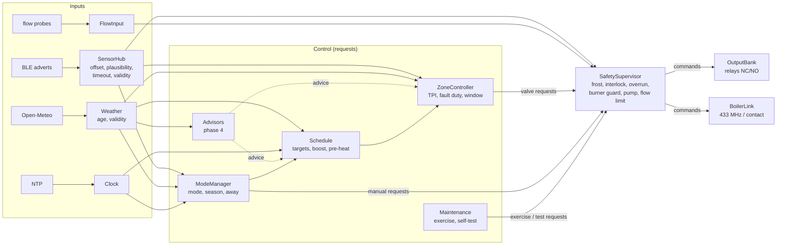

# Software Architecture — Smart Home Heating

**ASPICE:** SWE.2 (software architectural design).
**Baseline:** requirements v2 ([`requirements_and_features.md`](requirements_and_features.md), 31.10.2026) and the owner
decisions D1–D36 in [`requirements_review.md`](requirements_review.md).
**Status:** approved by the owner, 01.11.2026 — every decision AR-1…AR-20 (§19). The observations O-1…O-11 (§16)
are applied in requirements baseline v2 (commit 925ea91); this document follows them. No firmware or test was changed.
**Reference:** the requirements. The current code (`src/`, `include/`) was read as input only; §17 lists where it differs
from this architecture and §18 the order in which to close the gaps.

---

## 0. How to read this document

- Design decisions are rows `AR-n` (§19); the owner approves each one.
- A **request** is what a control function wants (open valve 3, boiler ON). A **command** is what is actually sent to an
  output. Only the safety layer creates commands.
- Parameters are written as `name` and are defined in requirements §6; this document cites names, not values
  (process rule R2). Budgets in §14 are the exception.
- `Module` is a software component; `Module::Part` is a unit inside it (detailed in SWE.3, not here).
- `O-n` rows (§16) are the observations this architecture raised on the requirements; all are applied in baseline v2.

---

## 1. Context and constraints

```
 BLE room sensors ── adverts ──▶ ┌──────────────────┐ ── relays ─────────▶ zone actuators (NC / NO), optional pump
 extra BLE receivers ── LAN ───▶ │    controller    │ ── 433 MHz / contact ▶ boiler receiver ─▶ boiler ON/OFF
 flow / return probes (option) ▶ │  ESP32-WROOM-32E │ ◀── HTTP / Telnet / Serial ── page, sh_esp_cli.py, sh_test_system.py
 Open-Meteo, NTP ── Internet ──▶ └──────────────────┘
```

| Item | Constraint | Source |
|---|---|---|
| Controller | ESP32-WROOM-32E, 4 MB flash, partitions `min_spiffs.csv`: NVS 20 KB, 2 × 1.875 MB app (OTA), LittleFS 128 KB | `platformio.ini` |
| Framework | Arduino-ESP32 2.0.14 (`espressif32@6.5.0`) on FreeRTOS; bootloader rollback is enabled in this core | `platformio.ini`, core `sdkconfig` |
| Libraries | vendored `ArduinoJson`, `NimBLE-Arduino`; core libraries (WiFi, WebServer, HTTPClient, Preferences, LittleFS, Update, Wire) may be used; any other library needs owner approval | AGENTS.md §3 |
| Firmware size | < 1.25 MB = 1 310 720 B (`FIRMWARE_MAX_BYTES` in `tools/sh_process_check.py`) | NFR-2.8 |
| Heap | ≥ 100 KB free in normal operation | NFR-2.2 |
| Loop | no blocking call in `loop()`; the only accepted block is one radio frame (FR-17.6) | AGENTS.md §3 |
| Zones | 1–32 zones, memory reserved statically | FR-69, NFR-2.6 |
| Autonomy | all decisions on the controller; network loss never stops control | NFR-1.1 |
| Priorities | safety > comfort > economy; faults are invisible to occupants, visible in DTC and log | NFR-5.1 |

---

## 2. Principles

| # | Principle | Requirement |
|---|---|---|
| P1 | **Safety has the last word.** Control modules produce requests only. `SafetySupervisor` turns them into commands and is the only module that holds the write handles of `OutputBank` and `BoilerLink`. | NFR-5.1, FR-2, FR-3, FR-4, FR-16.1, FR-37 |
| P2 | **One writer per resource.** Relay pins only in `OutputBank`, the radio pin only in `BoilerLink`, NVS only in `ParamStore`, LittleFS only in `History` and `Diagnostics::EventLog`. | NFR-2.9 |
| P3 | **Every input carries a validity** (`Ok`, `Held`, `Lost`, §8.1) and an age. Every consumer handles all three; `Lost` always leads to a defined fallback. | NFR-5.2 |
| P4 | **One parameter table.** Every §6 parameter is defined once (default, range, unit, NVS key, auth flag). API, console, import and NVS load all go through it. | R2, FR-42, NFR-2.9 |
| P5 | **Static memory.** All tables are sized at compile time for 32 zones. No `new`, no growing `String` / `std::vector` after boot; JSON goes into fixed buffers or is streamed. | NFR-2.6, FR-69 |
| P6 | **Cooperative loop, no blocking.** One control tick per second in `loop()`. Blocking network I/O runs in one worker task. Tasks share data only through two lock-protected mailboxes (§5.1). | AGENTS.md §3, FR-17.6 |
| P7 | **Advisors cannot stop control.** Phase-4 modules return a bounded `Advice`; when it is invalid or out of bounds the consumer uses the baseline rule. | NFR-5.3 |
| P8 | **One command path.** Page, API, console and tests call the same `Commands` functions, so limits, authentication and guards are identical for every source. | FR-1.2, FR-4, FR-17.3 |
| P9 | **Pure logic.** Control and safety logic get time and inputs passed in and call no Arduino API, so they can later be unit-tested on the PC (PlatformIO ships Unity, no new library). | SWE.4 readiness |

---

## 3. Static view

### 3.1 Layers

```
 L6 Interfaces   WebApi · Console · StatusModel · History                (read via StatusModel, write via Commands)
 L5 Commands     Commands                                                 (auth level, ranges, mode checks, result codes)
 L4 Control      ModeManager · Schedule · ZoneController · Maintenance    (requests only)
                 Advisors · PlantMonitor  [phase 4, optional]
 L3 Safety       SafetySupervisor                                         (requests → commands)
 L2 I/O          SensorHub · Weather · Clock · FlowInput                  (inputs with validity)
                 OutputBank · BoilerLink                                  (outputs, written only by L3)
 L1 Services     App · ParamStore · Diagnostics · FaultInjector · Network
```

A module uses modules of its own or a lower layer, plus L1 services. Upward data goes only as plain snapshots read in
the tick (§5.3). Forbidden dependencies are listed in §3.3.

### 3.2 Module list

| # | Module | Layer | One responsibility | Owns | Requirements | Today in |
|---|---|---|---|---|---|---|
| 1 | `App` | L1 | Boot order, the 1 s tick, task watchdog | boot phase, tick timers | FR-21 (boot message), NFR-1.4 (order), NFR-1.5 | `main.cpp` |
| 2 | `ParamStore` | L1 | The only NVS user: §6 parameters, zone configuration, persistent state; export, import, factory reset | NVS namespaces, RAM shadow, parameter table | §6, FR-9.2, FR-11.1 (empty defaults), FR-11.3, FR-11.4, FR-14.1, FR-18, FR-29, FR-30, FR-42, FR-49, FR-55, FR-58, FR-59, FR-61, FR-65, FR-66, FR-69, NFR-2.9, NFR-5.3 (load check) | `Preferences` in 4 files |
| 3 | `Diagnostics` | L1 | DTC table, event history, heap health | active DTC masks, event ring | FR-10.2, FR-17.5, FR-21, FR-55, FR-59, FR-62, NFR-2.2 | `DiagnosticEngine` |
| 4 | `FaultInjector` | L1 | Test-only masking of inputs | injection flags (RAM only) | NFR-5.5 | — |
| 5 | `Network` | L1 | Wi-Fi supervisor, setup access point, network worker task | Wi-Fi state, worker job slot | FR-9 (worker), FR-41, FR-50, NFR-1.1 | `main.cpp` |
| 6 | `Clock` | L2 | Valid local time or "no time" | time-valid flag | FR-12.1, FR-61 (validity) | `TimeAndWeatherService` |
| 7 | `SensorHub` | L2 | Turn adverts into accepted readings per zone | sensor table, mailbox, filter state | FR-6.1, FR-6.2, FR-6.3, FR-11.3 (discovery), FR-16.2, FR-18, FR-20, FR-22 (acquired), FR-28, FR-49, FR-53, FR-72 | `BleSensorScanner`, parts of `ThermalZoneManager`, `DiagnosticEngine` |
| 8 | `Weather` | L2 | Outdoor data with age | last result, daily mean, irradiance forecast | FR-9, FR-9.2, FR-12.2 (daily mean), FR-70 (forecast) | `TimeAndWeatherService` |
| 9 | `FlowInput` | L2 | Optional flow / return temperatures | probe backend state | FR-54 (input) | — |
| 10 | `OutputBank` | L2 | Logical outputs → physical channels, with NC / NO polarity | channel map, commanded state, energised-since and closed-since times | FR-14.1 (pump channel), FR-15.1, FR-19, FR-43, FR-69, NFR-1.4 (all closed) | `ThermalZoneManager::applyRelay`, `WebApi` relay test |
| 11 | `BoilerLink` | L2 | Carry boiler ON/OFF to the receiver | link type, last sent state, cooldown and heartbeat timers | FR-5.1, FR-5.2, FR-17.1 (no frame), FR-17.2, FR-17.6, FR-17.7, FR-55, FR-57, NFR-1.4 | `BoilerRadioTrigger` (transport part) |
| 12 | `ModeManager` | L4 | Operating mode, away, heating season | mode, manual timeout, away flag, season state | FR-1.3, FR-12.2, FR-44 (flag), FR-52, FR-64 | `ThermalZoneManager`, `TimeAndWeatherService::isHeatingSeason` |
| 13 | `Schedule` | L4 | Target temperature per zone | levels, slots, boosts, last level, pre-heat lead | FR-1.2 (apply), FR-29, FR-30, FR-31, FR-39, FR-44 (target), FR-48, FR-61, NFR-4.1 | `ThermalZoneManager` |
| 14 | `ZoneController` | L4 | Valve request per zone (TPI, sensor-loss duty, window pause) | zone control state, TPI cycle, learned duty table, window state | FR-16.2, FR-22 (zone), FR-40, FR-47, FR-51, NFR-4.1, NFR-5.3, NFR-5.4 | `ThermalZoneManager::evaluateTpi`, `evaluateWindowDetection` |
| 15 | `Maintenance` | L4 | Valve exercise, self-tests, OTA checks | idle times, self-test sequence, OTA verify state | FR-5.2, FR-8.3 (gate), FR-10.4, FR-19, FR-60, FR-68 (self-test result) | `ThermalZoneManager` anti-seize, `DiagnosticEngine::runSelfTest` |
| 16 | `SafetySupervisor` | L3 | Last word over every output (§6) | valve states, interlock and overrun timers, burner guard, pending boiler action, pump state, flow and frost latches | FR-1.3, FR-2, FR-3, FR-3.2, FR-4, FR-14.2, FR-14.3, FR-14.5, FR-16.1, FR-17.3, FR-17.4 (data), FR-17.5, FR-19, FR-22, FR-32, FR-37, FR-43 (execution), FR-54 (action), FR-60 (boiler OFF gate), FR-64, NFR-1.4, NFR-2.2 (restart gate), NFR-5.1 (order), NFR-5.4 | `ThermalZoneManager::update`, `BoilerRadioTrigger::canTransmit`, `WebApi`, `ConsoleCommands` |
| 17 | `Advisors` | L4 plug-in, phase 4 | Bounded hints (§13) | learned models | FR-40.2, FR-63, FR-67, FR-70, FR-71, NFR-5.3 | — |
| 18 | `PlantMonitor` | L4 observer, phase 4 | Detect plant faults (valve stuck, no effect, boiler not heating) | per-zone trend windows | FR-56, FR-57 | — |
| 19 | `Commands` | L5 | Every user action, identical for every source | stateless | FR-1.2 (limits), FR-7.3, FR-11.3 (mapping), FR-17.1 (response), FR-17.3, FR-17.4, FR-42, FR-43 (MANUAL check), FR-58 (auth level), FR-59, FR-65, FR-66, FR-68 (relay test) | `WebApi.cpp`, `ConsoleCommands.cpp` |
| 20 | `WebApi` | L6 | HTTP transport: routes, JSON, authentication check, CORS, page, OTA upload | — | FR-8.1 (serve), FR-8.3, FR-42, FR-45, FR-58, NFR-2.3, NFR-3.1 | `WebApi.cpp` |
| 21 | `Console` | L6 | Serial / Telnet / HTTP console and the log ring | log ring, Telnet client | FR-7.1, FR-7.3, FR-23, FR-45, NFR-2.4 | `NetworkConsole`, `ConsoleCommands` |
| 22 | `StatusModel` | L6 | One read-only snapshot for page, API and `STATUS` | static output buffer | FR-8.1 (data), FR-10.2 (show), FR-20 (show), FR-21, FR-23, FR-35 (show), FR-47 / FR-48 (admin view), FR-52 (warning), NFR-2.3 | `WebApi.cpp` handlers |
| 23 | `History` | L6 | Telemetry history and burner counters | LittleFS ring files, counters | FR-34, FR-35, NFR-4.1 (measurement) | `TelemetryHistoryManager`, counters in `BoilerRadioTrigger` |
| — | all modules | all | Cross-cutting rules: §2 principles, §8 fallbacks, §14 budgets | — | NFR-1.1 (no network dependency in L2–L4), NFR-2.6 (P5), NFR-2.8 (§14.1), NFR-3.1, NFR-3.2 (this table), NFR-5.1 (§8), NFR-5.2 (§8.2) | — |

The family / admin page (`web/index.html`, FR-8.1) is a static asset served by `WebApi`; its language (`pageLanguage`,
NFR-3.1) is read through `StatusModel`.

### 3.3 Dependency rules (checkable by grep)

| Rule | Text |
|---|---|
| R-A1 | `pinMode` / `digitalWrite` on relay pins only in `OutputBank`. |
| R-A2 | The radio pin and the frame transmitter only in `BoilerLink`. |
| R-A3 | `OutputBank::apply` and `BoilerLink::send` are called only by `SafetySupervisor`. |
| R-A4 | `Preferences` only in `ParamStore`; `LittleFS` only in `History` and `Diagnostics::EventLog`. |
| R-A5 | `FaultInjector` is read only by L2 inputs and `BoilerLink`; it has no reference to L3 or to outputs. |
| R-A6 | L6 modules change state only through `Commands` and read state only through `StatusModel`. |
| R-A7 | No `String`, `new` or growing container in L2–L4 after boot. |

These rules can become a check in `tools/sh_process_check.py` (process zone, follow-up).

---

## 4. Interfaces

### 4.1 Shared types

```cpp
enum class Validity : uint8_t { Ok, Held, Lost };          // §8.1
struct Measured   { float value; Validity validity; uint32_t ageS; };

struct ZoneReading { Measured temp; Measured rh; uint8_t batteryPct; int8_t rssi; LinkClass link; bool acquired; };
struct Outdoor     { Measured temp; Measured rh; Measured dailyMean; Measured irradiance3h; };
struct TimeNow     { bool valid; uint32_t epoch; uint16_t minuteOfDay; bool weekend; uint32_t uptimeS; };
struct ZoneTarget  { float targetC; TargetSource source; uint8_t level; };   // Level, Boost, Away, PreHeat, LastLevel
struct ValveRequest{ bool open; Reason reason; bool countsForBoiler; };     // Tpi, FaultDuty, Manual, Exercise, SelfTest
struct BoilerRequest { bool on; Source source; bool force; };               // Auto, Manual, SelfTest; force = OFF only
struct Advice      { float value; bool valid; };
struct CmdResult   { CmdStatus status; uint16_t waitSec; const char* message; };
// CmdStatus: Ok, Idempotent, BadRequest (400), Unauthorized (401), Conflict (409), RateLimited / Pending (429)
```

Temperatures are `float` in RAM and scaled integers (0.1 °C) in NVS and history, so "write on change" compares integers.

### 4.2 Interface table

| # | Interface | Provider → consumer | Content | Rate | Contract |
|---|---|---|---|---|---|
| I1 | Sensor mailbox | `SensorHub::BleScanner` (NimBLE task), `SensorHub::RemoteGateway` → `SensorHub` (loop) | MAC, temperature, RH, battery, RSSI, source, uptime | per advert | ring of 16 slots, oldest overwritten; spinlock held ≤ 2 µs; the callback never blocks or logs |
| I2 | `ZoneReading[z]` | `SensorHub` → `ZoneController`, `SafetySupervisor`, `ModeManager`, `PlantMonitor`, `Advisors`, `StatusModel` | accepted readings only (FR-53), offset applied (FR-49) | 1 s | §8.1 validity rules |
| I3 | `Outdoor` | `Weather` → `Schedule`, `ZoneController`, `ModeManager`, `Advisors` | temperature, RH, previous-day mean, irradiance next 3 h | 1 s snapshot, fetched every 15 min | `Held` up to 6 h, then `Lost` (FR-9) |
| I4 | `TimeNow` | `Clock` → `Schedule`, `ModeManager`, `Maintenance`, `History`, `Diagnostics` | local time, valid flag, uptime | 1 s | `valid = false` until NTP; uptime always valid |
| I5 | `ZoneTarget[z]` | `Schedule` → `ZoneController`, `StatusModel` | effective target and its source | 1 s | always defined (FR-61 fallback) |
| I6 | Requests | `ZoneController`, `ModeManager` (manual), `Maintenance` → `SafetySupervisor` | `ValveRequest[z]`, pump request, `BoilerRequest` | 1 s | a request is a wish; it may be delayed or refused |
| I7 | Commands | `SafetySupervisor` → `OutputBank`, `BoilerLink` | `apply(channel, open)`, `send(on)` | on change | the only output path (R-A3) |
| I8 | `SafetyState` | `SafetySupervisor` → `StatusModel`, `PlantMonitor`, `History`, `Maintenance`, `Commands` | valve state per zone, boiler state / pending / `waitSec` / flame lit, pump, active protections | 1 s | read-only |
| I9 | Parameters | `ParamStore` ↔ all | `get(id, zone)`, `set(id, value, zone)` → `Ok` / `OutOfRange` / `Unknown`; change counter | on demand | range check on every set and on load |
| I10 | Diagnostics | all → `Diagnostics` | `raise(dtc, zone)`, `clear(dtc, zone)`, `event(type, code, zone, value)` | on event | only codes of requirements §5 exist (enum) |
| I11 | Command API | `WebApi`, `Console` → `Commands` | one function per user action (§4.3) | on request | returns `CmdResult`; the transport maps it to HTTP code / console text |
| I12 | Advice | `Advisors` → `Schedule`, `ZoneController` | lead minutes, duty factor, target offset, window event, cycle phase | 1 s | consumer clamps; invalid → baseline rule (§13) |
| I13 | Fault injection | `Commands` → `FaultInjector` → inputs | `set(point, zone)`; inputs ask `masked(point, zone)` | on request | §11 |
| I14 | Worker slot | `Weather` ↔ `Network` worker | job (URL), result (ok, values, time) | every 15 min | spinlock copy of a small struct |

### 4.3 Commands (user actions)

| Group | Actions | Authentication (FR-58) |
|---|---|---|
| Comfort | boost / clear boost, away on/off, clear window pause, levels, schedule slots | no |
| Mode | season mode AUTO / ON / OFF, MANUAL on/off | MANUAL: yes |
| Manual outputs | valve, pump, boiler ON/OFF/cancel, relay test (MANUAL only, FR-43) | yes |
| Configuration | §6 parameters flagged `auth`, zone mapping, polarity, outputs, boiler link | yes |
| Maintenance | self-test, valve exercise, OTA, fault injection, restart | yes |
| Accounts | credentials, export / import, factory reset | yes |
| Read | status, zones, sensors, history, log, DTCs | no |

Endpoint names stay as in [`api_reference.md`](api_reference.md); the endpoint → command mapping is SWE.3 detail.

---

## 5. Dynamic view

### 5.1 Tasks

| Task | Core | Runs | Shares data via |
|---|---|---|---|
| Arduino `loop` | 1 | everything except the two rows below; registered with the 90 s task watchdog (NFR-1.5) | — |
| NimBLE host | 0 | passive scan, `BleScanner::onResult` → decode → mailbox | I1 |
| Network worker | 0, low priority | Open-Meteo HTTP and JSON parsing (blocking calls live here) | I14 |
| Wi-Fi / lwIP / SNTP | 0 | system tasks; `Clock` reads `time()` | — |

`WebServer` runs inside `loop()`; every handler is bounded (< 100 ms, NFR-2.3). A slow client can still hold
`handleClient()` up to the core's data wait (≈ 5 s). This is accepted: all safety timers compare elapsed `millis()`,
so a delay postpones a reaction but never shortens a guard.

### 5.2 Loop pass

1. Feed the task watchdog.
2. `WebApi.handleClient()`, `Console.poll()` (Serial, Telnet).
3. Every 1 s: control tick (§5.3).
4. Every 10 s: `Network.supervise()`, `Diagnostics.health()`.
5. `History.tick()` (record on the 5 min and 30 min boundaries).
6. `ParamStore.flush()` (debounced writes, e.g. page sliders).

### 5.3 Control tick (1 s, fixed order)



| Step | Modules | Notes |
|---|---|---|
| 1 Inputs | `Clock` → `SensorHub` (drain mailbox, filter, timeouts) → `Weather` (take worker result) → `FlowInput` | fault-injection masks are applied inside each input |
| 2 Modes | `ModeManager` | manual timeout, season, away |
| 3 Targets | `Schedule` | slot, boost end, pre-heat lead (advice from `HeatUpModel`) |
| 4 Control | `ZoneController` (window, TPI, fault duty, advice) → `Maintenance` | requests only |
| 5 Safety | `SafetySupervisor` → `OutputBank`, `BoilerLink` | §6.1 order |
| 6 Observe | `PlantMonitor`, `Diagnostics` (DTC changes flagged in steps 1–5), `StatusModel` (snapshot invalidated) | read-only |

### 5.4 Timing budget

| Activity | Budget | Source |
|---|---|---|
| Control tick, 32 zones | ≤ 20 ms, period 1 s | FR-37 (one cycle = 1 s) |
| API request | < 100 ms | NFR-2.3 |
| Radio frame | ≤ 300 ms, interrupts off ≤ 150 ms; at most one per `hbInterval` plus state changes | FR-17.6 |
| NVS write | on change only, typical < 30 ms | NFR-2.9 |
| LittleFS record append | < 30 ms, every 5 min | FR-34 |
| BLE callback | < 100 µs, no logging | P6 |
| OTA upload | `loop()` held up to 30 s, only with the boiler OFF, watchdog fed by the upload | FR-8.3, FR-60 |
| Boot Wi-Fi join | ≤ 12 s in `setup()`, after the outputs are in the safe state | NFR-1.4, FR-50 |

### 5.5 Boot sequence (NFR-1.4)

1. `App`: serial, log, `ParamStore.begin()` (load + range check, §9.3).
2. `OutputBank.begin()`: every channel driven closed per its polarity — the first output action after reset.
3. `BoilerLink.begin()`: one OFF frame (or contact open).
4. `SafetySupervisor.begin()`: `SAFE_BOOT` → `WARMUP` (§7.7).
5. `Diagnostics.begin()`: reset reason → event (watchdog reset, controlled restart).
6. `Network.begin()` (join or access point, FR-50), `Clock.begin()` (SNTP async), `SensorHub.begin()`,
   `Weather.begin()`, `History.begin()`, `WebApi` / `Console`.
7. Task watchdog armed; `Maintenance.begin()` checks whether the running image waits for verification (FR-60).
8. `loop()`.

---

## 6. Safety layer — `SafetySupervisor`

### 6.1 Parts and evaluation order (every tick)

| # | Part | Does | Requirement |
|---|---|---|---|
| S0 | `BootGate` | no heating command until the outputs are closed and the OFF frame is sent | NFR-1.4 |
| S1 | `FlowLimit` | flow > `flowMax` for 2 min → latch boiler-OFF override; release at `flowMax` − 5 °C | FR-54 |
| S2 | `QuietGate` | on a request from OTA or a controlled restart: hold the boiler OFF (through S8), report "quiet" when the boiler is OFF and no overrun runs | FR-60, NFR-2.2 |
| S3 | `FrostGuard` | every zone, enabled or disabled, with an accepted reading below `frostTemp` → valve request open (counts for boiler) until `frostTemp` + 1.5 °C, in every mode | FR-16.1 |
| S4 | Request merge | per zone: requests of the active source (AUTO: `ZoneController`; MANUAL: manual; OFF: only the FR-51 sensor-loss duty, §7.1) ∪ frost ∪ exercise ∪ self-test | FR-1.3, FR-64, FR-19 |
| S5 | `ValveArbiter` | valve state machine per output (§7.2): open / close per merged request, close within one tick, overrun hold, MANUAL relay test | FR-37, FR-3, FR-3.2, FR-43 |
| S6 | `Interlock` | boiler permitted only if a boiler-counting valve is `OPEN` (energised ≥ `interlockDelay`); MANUAL with `openLoopBypass` is permitted without a valve | FR-2, FR-1.3 |
| S7 | Boiler decision | desired ON = boiler-counting demand ∧ permitted ∧ ¬`FlowLimit` ∧ ¬`QuietGate`; in MANUAL = manual boiler request ∧ permitted | FR-2, FR-19, FR-54 |
| S8 | `BurnerGuard` | `burnerMinRun` / `burnerMinPause` on every change from every source; inside the guard → `PENDING_ON` / `PENDING_OFF`; opposite request or cancel clears it; only OFF can be forced; rejections counted | FR-4, FR-32, FR-17.3, FR-17.4 (data), FR-17.5 |
| S9 | `PumpGuard` | pump ON only while a valve is `OPEN` ≥ `interlockDelay`, during exercise, or during overrun with the hold valve open | FR-14.2, FR-14.3, FR-14.5, FR-19 |
| S10 | Emit + self-check | write changed commands; then check invariants I-1…I-8; a violation forces boiler and pump OFF and records an event | P1 |

### 6.2 Invariants

| # | Invariant | Requirement |
|---|---|---|
| I-1 | Boiler ON command ⇒ a valve is energised ≥ `interlockDelay` (exception: MANUAL with `openLoopBypass`). | FR-2, FR-1.3 |
| I-2 | Every boiler state change respects `burnerMinRun` / `burnerMinPause`, except a forced OFF. | FR-4, FR-17.3 |
| I-3 | Valve energised ⇒ demand ∨ frost ∨ overrun hold ∨ exercise ∨ manual / test request. | FR-37 |
| I-4 | Pump ON ⇒ a valve is energised. | FR-14.5 |
| I-5 | Zone with accepted reading < `frostTemp` ⇒ its valve is requested open, in every mode. | FR-16.1 |
| I-6 | Only `SafetySupervisor` writes outputs. | P1 (R-A3) |
| I-7 | No heating command before the boot safe state is complete. | NFR-1.4 |
| I-8 | Flow > `flowMax` for 2 min ⇒ boiler OFF. | FR-54 |

### 6.3 What the safety layer does not do

No targets, no TPI, no schedule, no comfort decisions. It opens a valve on its own only for frost; the overrun hold keeps
an already open valve open. Everything else arrives as a request.

---

## 7. State machines

### 7.1 Zone control state — `ZoneController`, per zone

| State | Valve request | Enter | Leave |
|---|---|---|---|
| `DISABLED` | closed; exception: sensor-loss duty (FR-51, below) | zone disabled | enabled → `ACQUIRING` (no reading yet) or `NORMAL` |
| `ACQUIRING` | closed | boot | first accepted reading → `NORMAL`; warmup end (300 s or all mapped sensors received) → `FAULT` + DTC-101 (FR-22) |
| `NORMAL` | TPI (FR-47) | accepted reading | reading `Lost` → `FAULT`; window event → `WINDOW` |
| `FAULT` | learned duty for the outdoor band, `faultDuty` if nothing learned (FR-51), with TPI timing | reading `Lost` (> `sensorTimeout`) | first accepted reading → `NORMAL`, DTC-101 cleared |
| `WINDOW` | closed | window event (FR-40, FR-40.2) | 30 min, rebound 0.6 °C, or clear → always back to `NORMAL` |

- Learning (FR-47) runs only in `NORMAL` with mode AUTO, never in `FAULT` or `WINDOW`.
- In MANUAL and OFF the controller keeps computing (shown in the admin view), but `SafetySupervisor` ignores its
  requests (S4), except the sensor-loss duty below.
- **Sensor-loss duty in global OFF and for a disabled zone (FR-51):** a zone whose sensor is `Lost` runs its FR-51
  duty only while outdoor is below `faultFrostOutdoor` or `Lost`.
- **Learned duty table (AR-12):** per zone, one learned base duty per outdoor band of 5 °C (7 bands: below −10 … 15 and
  above). TPI uses the band of the current outdoor temperature; an empty band starts from the nearest learned band.
  `FAULT` uses the same table, so FR-51 gets "the learned duty for the current outdoor temperature". Outdoor `Lost` →
  last used band.
- **Displayed zone state** (page, API) is derived, highest first: `FROST` (safety latch) > `FAULT` > `WINDOW` >
  `HEATING` (valve `OPENING` / `OPEN`) > `IDLE`; `DISABLED` separately.

### 7.2 Valve state — `SafetySupervisor::ValveArbiter`, per output

| State | Output | Enter | Leave |
|---|---|---|---|
| `CLOSED` | de-energised (per polarity) | boot; request ended (no hold) | request open → `OPENING` |
| `OPENING` | energised, time < `interlockDelay` | request open | time ≥ `interlockDelay` → `OPEN`; request ended → `CLOSED`, no boiler ON for it (FR-37) |
| `OPEN` | energised, counts for the interlock | time ≥ `interlockDelay` | request ended: last boiler-counting valve while the flame is lit → `HOLD`; otherwise → `CLOSED` |
| `HOLD` | energised (overrun) | last valve, flame lit | boiler OFF frame sent + `overrun` elapsed → `CLOSED`; new request → `OPEN` |

- `HOLD` starts when the last demand ends and lasts while the boiler is ON or `PENDING_OFF`, then `overrun` after the
  OFF frame (AR-11, observation O-1). If the flame was never lit, no `HOLD` (FR-3.2).
- Valve exercise uses `OPENING` / `OPEN` with `countsForBoiler = false` for 5 min, then `CLOSED`.
- `OutputBank` keeps energised-since (interlock) and closed-since (FR-19 idle days, stored on change).

### 7.3 Boiler — `SafetySupervisor::BurnerGuard`

| From | Condition | To | Action |
|---|---|---|---|
| `OFF` | desired ON, pause ≥ `burnerMinPause` | `ON` | send ON, flame lit |
| `OFF` | desired ON, pause < `burnerMinPause` | `PENDING_ON` | report `waitSec` |
| `PENDING_ON` | guard expired, still desired and permitted | `ON` | send ON, flame lit |
| `PENDING_ON` | desire ended, cancel, or interlock lost | `OFF` | nothing sent; flame never lit (FR-3.2) |
| `ON` | desired OFF, run ≥ `burnerMinRun` | `OFF` | send OFF; overrun starts |
| `ON` | desired OFF, run < `burnerMinRun` | `PENDING_OFF` | hold valve stays open (§7.2) |
| `PENDING_OFF` | guard expired | `OFF` | send OFF; overrun starts |
| `PENDING_OFF` | desired ON again | `ON` | nothing sent (cancel) |
| `ON`, `PENDING_OFF` | forced OFF (manual), `FlowLimit`, or invariant violation | `OFF` | send OFF at once (FR-17.3) |

Rejected manual requests return `RateLimited` / `Pending` with `waitSec` (FR-17.4); more than 3 within 10 s raise
DTC-201 (FR-17.5).

### 7.4 Boiler link — `BoilerLink`

| State | Meaning | Leave |
|---|---|---|
| `IDLE` | last state delivered | new state, or `hbInterval` elapsed with heartbeat on → `SENDING` (FR-17.7) |
| `SENDING` | one frame (radio) or contact switch | done → `COOLDOWN` |
| `COOLDOWN` | 3 s; a new frame is refused (FR-17.2), the supervisor retries next tick | 3 s elapsed → `IDLE` |

- Fail-safe status: `ContactLink` always fail-safe; `Rf433Link` and `ReceiverLink` fail-safe only with
  `boilerLinkHeartbeat` on; otherwise DTC-207 stays active (FR-55).
- Link health is `Unknown` for one-way links; a future two-way receiver may report `Ok` / `Lost`.
- FR-57 "re-send ON once" is a transport repeat of the same state (`BoilerLink::resend`), requested by
  `PlantMonitor` through `SafetySupervisor`; it never changes the boiler state.

### 7.5 Operating mode — `ModeManager`

| Effective mode | Valve / boiler requests from | Still active |
|---|---|---|
| `AUTO` | `ZoneController`; away and boost change targets | all safety parts, exercise |
| `MANUAL` | user via `Commands`; returns to AUTO after `manualTimeout` (uptime based, FR-52) | frost, interlock (unless `openLoopBypass`), burner guard, overrun, pump guard, exercise |
| `OFF` | none (global OFF, FR-64); exception: sensor-loss duty (FR-51, §7.1) | frost, exercise, all guards |

Effective mode = `MANUAL` while a manual session runs, else `AUTO` if the season state is `HEATING`, else `OFF`.
Manual global OFF is season mode `OFF` (FR-12.2: "season OFF = global OFF"), so there is one switch, not two.

### 7.6 Heating season — `ModeManager::Season`

| From | Condition | To |
|---|---|---|
| `SUMMER` | season mode `ON` | `HEATING` |
| `SUMMER` | mode `AUTO` and previous-day mean < `heatLimit` for `seasonOnDays` days in a row | `HEATING` |
| `SUMMER` | safety net: an enabled zone with accepted readings below its night level for 12 h (mode `AUTO` only, O-6) | `HEATING` |
| `HEATING` | season mode `OFF` | `SUMMER` |
| `HEATING` | mode `AUTO` and previous-day mean > `heatLimit` + 2 °C for `seasonOffDays` days in a row | `SUMMER` |

- The daily mean is Open-Meteo's mean of the previous day, fetched once per day by `Weather`; a day without data does
  not count and does not reset the counters (fallback "state unchanged").
- State and counters are stored on change (at most once a day); every change is an event and a log line.

### 7.7 Boot and OTA — `App`, `SafetySupervisor::BootGate`, `Maintenance::Ota`

| State | Meaning | Leave |
|---|---|---|
| `SAFE_BOOT` | outputs closed, OFF sent | done → `WARMUP` |
| `WARMUP` | ≤ 300 s; zones with readings control normally, frost active (FR-22) | all mapped sensors received or 300 s → `RUN` |
| `RUN` | normal operation | OTA request → `OTA_WAIT_QUIET` |
| `OTA_WAIT_QUIET` | `QuietGate` holds the boiler OFF | quiet → upload accepted; no upload in 10 min → `RUN` |
| `PENDING_VERIFY` | first boot of a new image | within 60 s: loop and watchdog alive, Wi-Fi up, sensors received → image valid; otherwise → rollback, DTC-303 |

OTA verification uses the core's rollback hook (`verifyRollbackLater()` returns true, then
`esp_ota_mark_app_valid_cancel_rollback()` or `esp_ota_mark_app_invalid_rollback_and_reboot()`); the bootloader of
Arduino-ESP32 2.0.14 has rollback enabled, so no new library is needed (AR-17). An upload refused because the boiler
is ON returns HTTP 409 with `waitSec`.

---

## 8. Graceful degradation (NFR-5)

### 8.1 Validity model

| Input | `Ok` | `Held` | `Lost` | Owner |
|---|---|---|---|---|
| Zone temperature | latest raw reading accepted | last accepted reading; the latest raw one was out of range or is a spike waiting for confirmation (FR-53) | no accepted reading for > `sensorTimeout`, or never | `SensorHub` |
| Zone humidity | as temperature | as temperature | sensor `Lost` or format without RH | `SensorHub` |
| Outdoor temperature / RH | last poll succeeded | last poll failed, value ≤ 6 h old | > 6 h old or never (FR-9) | `Weather` |
| Previous-day mean | fetched today | — | not fetched today | `Weather` |
| Irradiance forecast | last poll succeeded | ≤ 6 h old | older or never | `Weather` |
| Time | NTP synced | — | not synced (DTC-302) | `Clock` |
| Flow / return | plausible readings | — | missing or implausible (DTC-206), or `flowSensors` off | `FlowInput` |
| Learned values | inside bounds | — | out of bounds or corrupt → default, DTC-301 | `ParamStore`, `ZoneController`, `Advisors` |

### 8.2 Fallback matrix

Every row can be triggered for test as named in the last column (§11).

| Feature | Fails | Fallback (inside comfort and safety) | Module | Reported | Injection |
|---|---|---|---|---|---|
| TPI (FR-47) | zone temperature `Lost` | learned duty for the outdoor band; `faultDuty` if nothing learned; frost, interlock, guards stay; global OFF and disabled zones per §7.1 (FR-51) | `ZoneController` | DTC-101, state FAULT | `sensor-lost <z>` |
| TPI | spike / out of range | last accepted reading (`Held`) until timeout (FR-53) | `SensorHub` | DTC-103, DTC-104 | — |
| Learned duty, heat-up model | out of bounds, corrupt NVS | default, control continues (NFR-5.3) | `ParamStore`, consumers | DTC-301 | — |
| Pre-heat (FR-48) | outdoor `Lost` | 90 min | `Schedule` | log | `weather-lost` |
| Pre-heat (FR-67) | model invalid | FR-48 formula | `Schedule` | log | — |
| Schedule (FR-31) | time `Lost` | last active level per zone (FR-61) | `Schedule` | DTC-302 | `time-lost` |
| Boost end (FR-39) | time `Lost` | `boostDuration` on uptime | `Schedule` | — | `time-lost` |
| Season (FR-12.2) | no daily mean | state unchanged; safety net | `ModeManager` | log | `weather-lost` |
| Smart window (FR-40.2) | outdoor or RH `Lost` | simple rule FR-40 | `ZoneController` | log | `weather-lost`, `humidity-lost` |
| Window pause (FR-40) | false detection | ends after 30 min at most; frost overrides | `ZoneController`, `FrostGuard` | log | — |
| Solar (FR-70) | forecast `Lost` | no reduction | `Advisors` | log | `weather-lost` |
| Humidity compensation (FR-71) | RH `Lost` | no compensation | `Advisors` | — | `humidity-lost` |
| Boiler link (FR-55) | controller dead / frames lost | receiver opens the boiler contact; on recovery the state is re-sent (FR-17.7) | `BoilerLink`, receiver | DTC-207 when not fail-safe | `boiler-link-lost` |
| Boiler not heating (FR-57) | lockout, link lost | re-send ON once, then DTC (timing in FR-57) | `PlantMonitor` | DTC-204 | — |
| Flow limit (FR-54) | flow > `flowMax` | boiler OFF until `flowMax` − 5 °C, then normal with all guards | `SafetySupervisor` | DTC-205 | `flow-high` |
| Flow probes (FR-54) | missing / implausible | flow functions disabled; boiler setpoint is the protection | `FlowInput` | DTC-206 | `flow-lost` |
| Wi-Fi / Internet | down | local control continues; weather fallbacks above | `Network` | DTC-401 | `weather-lost` |
| Heap (NFR-2.2) | < 60 KB / < 30 KB | DTC; below 30 KB controlled restart through `QuietGate`, state from NVS | `Diagnostics`, `SafetySupervisor` | DTC-402, event | — |
| Reboot, watchdog | any | NVS restore, boot warmup | `App` | event | restart command |
| OTA (FR-60) | bad image | rollback to the previous image | `Maintenance` | DTC-303 | — |
| Self-test (FR-60) | a plant step fails | result stored, no rollback | `Maintenance` | DTC-304 | — |
| Valve stuck (FR-56, FR-57) | hardware | DTC, other zones continue | `PlantMonitor` | DTC-202, DTC-203 | — |
| Credentials (FR-59) | default active | everything works | `ParamStore` | DTC-403 | — |
| Sensor battery, signal | low | control continues | `SensorHub` | DTC-102, DTC-105 | — |
| Event history (FR-62) | LittleFS not mounted | events kept in RAM until reboot | `Diagnostics` | log | — |
| Output expansion (FR-69) | expansion not responding | its outputs count as closed (unpowered state); other zones continue | `OutputBank`, `SafetySupervisor` | DTC-208 | — |

---

## 9. Parameter store — `ParamStore`

### 9.1 Record kinds

| Kind | Content | Write policy |
|---|---|---|
| Parameter | every global §6 parameter (per-zone rows are zone configuration) | after a passed range check, only if the stored integer differs; page sliders debounced 3 s |
| Zone configuration | per zone (zone mapping of §6): name, sensor MAC, output, levels, sensor offset, `circuits`, `solarGain`, `humidityComp` | on change |
| State | learned duty table, last schedule level, season state and counters, valve closed-since times, boiler last command, burner counters, OTA flags, credentials | learned values: change ≥ 5 % (FR-47); burner counters: at flame OFF and every 15 min while burning; the rest: on change |

### 9.2 Parameter table

One `const` table in flash; each entry: id, NVS key, unit, integer scale, default, min, max, flags
(`AUTH` = FR-58 write protection, `PER_ZONE`, `LEARNED` = NFR-5.3, `REBOOT` = applied at next boot).
`AUTH` is set exactly for what FR-58 lists (safety parameters, zone outputs, credentials); comfort settings have none.

### 9.3 Load, validation, migration

- At boot every record is read: missing → default; out of range or wrong size → default and an event
  (DTC-301 if `LEARNED`). This also repairs the board's per-zone window threshold 0.3 °C (retired; global
  `windowThreshold` is used).
- A schema version key drives a one-time migration from today's keys (`zones/*`, `sched/cfg2`, `boiler/*`, weather
  location); old keys are removed after a successful copy.
- Export / import (FR-65) and factory reset (FR-66, keeps Wi-Fi) are `ParamStore` operations; import uses the same range
  check as `set`.

### 9.4 NVS budget (20 KB partition, about 16 KB usable)

| Namespace | Content | Estimate |
|---|---|---|
| `cfg` | ~50 parameters | 1.6 KB |
| `zone` | 32 blobs × ~40 B | 3.0 KB |
| `learn` | one blob, 32 zones × 7 bands | 0.3 KB |
| `state` | season, last level, closed-since, boiler, counters, OTA | 0.8 KB |
| `cred` | Wi-Fi, OTA / API, access point | 0.5 KB |
| **Total** | | **≈ 6 KB (≈ 40 %)** |

The event history lives in LittleFS (§10) to keep NVS free for parameters (AR-6).

---

## 10. DTC and event store — `Diagnostics`

- **DTC table:** an `enum` with exactly the codes of requirements §5 (R4: the firmware can raise only defined codes).
  Each code has one raising module (table below) and a 32-bit zone mask, so per-zone codes (DTC-101…105, 202, 203) need
  no dynamic list. Clear conditions are those of §5; "manual clear" codes (DTC-301, DTC-303) are cleared by a command.
- **Event history (FR-62):** ring of 50 records × 16 B (time — epoch or uptime with a flag —, type, code, zone, value)
  in one LittleFS file, one record written per event. Types: DTC raised / cleared, frost on / off, FAULT on / off,
  watchdog reset, controlled restart, season change, OTA, invariant violation, parameter reset. The same code and zone
  are recorded at most 6 times per hour; further repeats are counted in the last record (flash wear and history
  stay bounded).
- **Health:** free heap, minimum, largest block every 10 s (FR-23, NFR-2.2); health score for FR-10.4.

| DTC | Raised by |
|---|---|
| DTC-101 | `SensorHub` (timeout, warmup end) |
| DTC-102 | `SensorHub` |
| DTC-103 | `SensorHub` |
| DTC-104 | `SensorHub` |
| DTC-105 | `SensorHub` |
| DTC-201 | `SafetySupervisor::BurnerGuard` |
| DTC-202 | `PlantMonitor` |
| DTC-203 | `PlantMonitor` |
| DTC-204 | `PlantMonitor` |
| DTC-205 | `SafetySupervisor::FlowLimit` |
| DTC-206 | `FlowInput` |
| DTC-207 | `BoilerLink` |
| DTC-208 | `OutputBank` (expansion) |
| DTC-301 | `ParamStore`, `ZoneController`, `Advisors` |
| DTC-302 | `Clock` |
| DTC-303 | `Maintenance::Ota` |
| DTC-304 | `Maintenance::SelfTest` |
| DTC-401 | `Network` |
| DTC-402 | `Diagnostics::Health` |
| DTC-403 | `ParamStore` (credentials) |

This table is the only DTC → module allocation; §3.2 lists requirements only.

---

## 11. Fault injection — `FaultInjector` (NFR-5.5)

| Point | Effect | Expected fallback | Refused when |
|---|---|---|---|
| `sensor-lost <z>` | zone reading → `Lost` | FR-51 | never |
| `humidity-lost [z]` | RH → `Lost` | FR-40.2 → FR-40, FR-71 off | never |
| `weather-lost` | outdoor, daily mean, forecast → `Lost` | FR-48 90 min, season unchanged, FR-40, FR-70 off | never |
| `time-lost` | `TimeNow.valid = false` | FR-61, boost on uptime, DTC-302 | never |
| `boiler-link-lost` | `BoilerLink` sends no frame | receiver turns the boiler OFF | link not fail-safe (heartbeat off): the boiler would stay ON without control |
| `flow-high` | flow = `flowMax` + 5 °C | FR-54 boiler OFF, DTC-205 | `flowSensors` off |
| `flow-lost` | flow → `Lost` | DTC-206, flow functions off | `flowSensors` off |

- Injection only removes an input or pushes it toward the protective side; it never creates a value that would suppress
  a protection (no "warm reading", no "flow OK"). It has no reference to the safety layer or the outputs (R-A5), so it
  cannot bypass a safety rule by construction.
- Flags live in RAM only; clearing an injection reboots the controller (NFR-5.5). Active injections are shown in status
  and recorded as events. Injection requires authentication (O-11).

---

## 12. Abstractions

### 12.1 Outputs — `OutputBank`

```cpp
class OutputChannel { public: virtual void write(bool energised) = 0; };      // physical level only
// backends: GpioChannel (ESP32-Relay X4, now); ExpanderChannel (I2C expander or relay board, later — hardware open)
```

- Logical outputs: zone 1…32 valves and one pump; each mapped to one channel in the zone configuration.
  A zone without a channel is rejected (FR-69).
- Polarity NC / NO is applied here and nowhere else (FR-15.1): `apply(zone, open)` → energised = open for NC,
  not open for NO.
- Static arrays for 32 zones + pump; the number of channels comes from the configured hardware.
- An expander backend would use the core `Wire` library (no new library). When it stops responding, its outputs count
  as closed (their unpowered state), `ValveArbiter` treats those valves as `CLOSED` (they no longer count for the
  interlock), DTC-208 is raised and the other zones continue (FR-69). Bus details are fixed with the hardware.

### 12.2 Boiler link — `BoilerLink`

```cpp
class BoilerLink { public:
  virtual SendResult send(bool on) = 0;   // Ok, Idempotent (same state, no frame), Cooldown
  virtual void tick(uint32_t nowMs) = 0;  // heartbeat repeat (FR-17.7)
  virtual bool isFailSafe() const = 0;    // FR-55, drives DTC-207
  virtual LinkHealth health() const = 0;  // Unknown for one-way links
};
// Rf433Link    — today: original-thermostat OOK frame (FR-5.1), cooldown 3 s (FR-17.2), timing FR-17.6
// ContactLink  — dry NO relay contact on the controller: power loss = open = boiler OFF (FR-55 wired)
// selected by `boilerLinkType`: rf433 → Rf433Link, wired → ContactLink, receiver → ReceiverLink
// ReceiverLink — future ESP32-class receiver with heartbeat timeout 3 × hbInterval (transport open: 433 MHz, Wi-Fi, BLE)
```

The burner guard (FR-4) is **not** in the link: it sits in `SafetySupervisor`, so every backend has the same guard.

### 12.3 Inputs

| Input | Backends | Notes |
|---|---|---|
| Room sensors | `BleScanner` (NimBLE passive, PVVX / ATC / BTHome v2, FR-6.x, FR-28); `RemoteGateway` (extra ESP32 receivers over LAN, FR-72, nice to have) | both write mailbox I1; `SensorHub` keeps the most recent accepted reading per sensor; optional per-sensor BTHome key later (FR-53 note, mbedtls in core) |
| Flow / return | `FlowProbe` interface; backend open (DS18B20 needs `OneWire` + `DallasTemperature` = new libraries, owner approval) | disabled unless `flowSensors` on |
| Outdoor | Open-Meteo through the network worker | location from `ParamStore` (FR-9.2) |
| Time | SNTP with the Romanian time zone (FR-12.1) | |

---

## 13. Phase-4 modules — `Advisors`, `PlantMonitor`

Contract for every advisor:

1. **Optional:** compiled in, enabled by parameter; disabled = baseline behaviour.
2. **Bounded:** output clamped by the consumer to fixed bounds; learned values follow NFR-5.3 (out of bounds →
   default, DTC-301).
3. **Never in the safety path:** advisors talk only to `Schedule` / `ZoneController`; they cannot hold a request or a
   command.
4. **Time-boxed:** ≤ 2 ms per tick each; heavy work is split over ticks.
5. **Static memory:** ≤ 2 KB RAM each (32 zones).
6. **Fallback named:** `valid = false` → the baseline rule below.

| Module | Advice | Consumer | Baseline when invalid | Requirement |
|---|---|---|---|---|
| `HeatUpModel` | pre-heat lead per zone (°C/h vs outdoor, learned) | `Schedule` | FR-48 formula | FR-67 |
| `SmartWindow` | window event per zone (slope, absolute humidity, ΔT indoor–outdoor) | `ZoneController` | FR-40 simple rule | FR-40.2 |
| `SolarThrottle` | duty factor per flagged zone from irradiance forecast | `ZoneController` | no reduction | FR-70 |
| `HumidityComp` | target offset 0…−0.5 °C per zone with `humidityComp` | `Schedule` | no compensation | FR-71 |
| `CycleAligner` | TPI cycle phase; grouping of a small zone with another | `ZoneController` | independent cycles | FR-63 (`circuits` per zone, `minLoops`) |
| `PlantMonitor` | DTC-202 / 203 / 204; one transport re-send of ON | `Diagnostics`, `SafetySupervisor` | no detection | FR-56, FR-57 |

---

## 14. Resource budget

### 14.1 Flash (NFR-2.8)

| Item | Bytes |
|---|---|
| Limit (`FIRMWARE_MAX_BYTES`) | 1 310 720 |
| Build of 31.10.2026 (`.pio/build/esp32dev/firmware.bin`) | 1 196 192 |
| **Margin today** | **114 528 (≈ 112 KB)** |
| Estimated additions, baseline v2 (parameter table, commands and auth, events, fault injection, OTA verify, season) | ≈ 15–25 KB |
| Estimated additions, phase 4 advisors and plant monitor | ≈ 10–20 KB |
| Expected savings (streamed JSON instead of `String`, one DTC path, shorter log texts) | ≈ 10–20 KB |

Rule (AR-18): keep at least **40 KB** margin; a change that would go below needs a removal first. CI already fails above
the limit (`sh_process_check.py`).

### 14.2 RAM (NFR-2.2, NFR-2.6)

Measured 30.10.2026: 110 KB free heap with 3 zones (`system_test_report.md`, TC01.2). The margin to 100 KB is small,
so the budget below is a target to measure at each migration step, not a promise.

| Item | Today | Target |
|---|---|---|
| Zone tables (config + runtime) | 3 zones, ~1 KB | 32 × ~160 B ≈ 5 KB |
| Sensor table | 8 × ~70 B | 40 × ~48 B ≈ 2 KB |
| Mailbox | — | 16 × 24 B ≈ 0.4 KB |
| Telemetry rings in RAM | 5.3 KB | 0.1 KB (one record; rings in LittleFS, AR-15) |
| Event ring mirror | — | 0.8 KB |
| Log ring | 8 KB | 8 KB |
| Network worker stack | — | ≈ 5 KB (AR-3) |
| Status / JSON buffer | `String` growth | 4 KB static, history streamed |
| **Net change** | | **≈ +10 KB static, minus `String` churn** |

Savings to look for if the measurement shows < 100 KB: NimBLE connection count (observer only), log ring size,
`WebServer` buffers. If none is enough, the owner decides between features and the limit.

### 14.3 CPU and timing

§5.4. The control tick for 32 zones is linear and small (TPI, filter, state machines), estimated well below 20 ms.

### 14.4 Flash wear

| Writer | Rate | Assessment |
|---|---|---|
| NVS parameters | on user change | negligible |
| NVS learned table | ≤ 1 write per zone per hour (TPI cycle), only on ≥ 5 % change | negligible |
| NVS burner counters | flame OFF + every 15 min while burning (today's rate) | acceptable, NVS wear-levels over 5 pages |
| LittleFS history | 1 record per 5 min (today: full files rewritten every 5 min) | lower than today |
| LittleFS events | per event, ≤ 6 per code and hour | negligible |

---

## 15. Traceability — requirement → module

The allocation is kept in one direction and one place: the Requirements column of §3.2 (module level; parts are
SWE.3). Every ID is written in full, never as a range. `python tools/sh_process_check.py trace` checks it against the
requirements: a cited ID that is not an active requirement is an ERROR, an active requirement without a module is a
WARN. `trace --matrix` writes the generated matrix requirement → module → test → code.

Struck (`~~`) requirements are retired and have no module; remnants in the code are in §17. DTC → module is §10.

---

## 16. Observations on the requirements

All rows are applied in requirements baseline v2, commit 925ea91 (decision log: `requirements_review.md` §6);
FR-58 was clarified afterwards. The columns keep the original observation; the requirements are the reference.

| # | Requirement | Observation | Proposal for the requirements chat |
|---|---|---|---|
| O-1 | FR-3, FR-4, FR-37 | When the last demand ends while the burner is inside `burnerMinRun`, the OFF is deferred (FR-32) but FR-37 closes the valve within 1 s; FR-3 keeps a valve open only *after* the OFF. The boiler can burn up to `burnerMinRun` with all zone valves closed (today's code does this). | The overrun valve stays open while the boiler is ON or `PENDING_OFF`, then for `overrun` after the OFF (AR-11). **Safety.** ✅ owner 01.11.2026 |
| O-2 | FR-16.1, FR-51, FR-64 | Frost protection needs an accepted reading. A zone whose sensor is lost gets no frost protection in global OFF (FR-51 heats only in AUTO), nor a disabled zone without sensor. **Safety.** | Applied: in global OFF and for a disabled zone, a zone in sensor `FAULT` runs its FR-51 duty while outdoor is below `faultFrostOutdoor` (5 °C, −10…+10 °C) or unknown. ✅ owner 01.11.2026 |
| O-3 | NFR-3.2 | Lists today's module names, which this architecture replaces. | "Firmware is split into the modules of `docs/architecture.md`, one responsibility each." |
| O-4 | §6 | Configuration used by requirements but missing in §6: actuator type (FR-15.1), pump output (FR-14.1), boiler link type (FR-55), season mode (FR-12.2), location (FR-9.2), page language (FR-8.1), credentials (FR-59), zone count / mapping (FR-69), circuits per zone (FR-63), `solarGain` / humidity-compensation flags. | Add them to §6 with default and range (R2). |
| O-5 | FR-54 | Does the flow-limit OFF wait for `burnerMinRun`? | Forced OFF at once (safety > burner wear); the 2 min filter already prevents chatter. ✅ owner 01.11.2026 — only relevant when the optional flow-temperature probes are fitted (none in the reference install). |
| O-6 | FR-12.2 | Does the 12 h safety net also switch ON when the owner chose season OFF by hand (e.g. holiday in winter)? | Safety net only in season mode AUTO; frost protection covers safety. ✅ owner 01.11.2026 |
| O-7 | NFR-1.4, FR-22 | NFR-1.4 says warmup runs "before any heating command"; FR-22 lets zones with readings heat during the warmup. | Reword NFR-1.4: "… and enters the boot warmup (FR-22) before any heating command." |
| O-8 | FR-62 | No fallback clause (NFR-5.2) when the event store cannot be written. | "Events are kept in RAM until reboot; log line." |
| O-9 | FR-47, FR-51 | FR-47 learns one base duty per zone; FR-51 wants "learned duty for the current outdoor temperature". | FR-47: learned base duty per zone and outdoor band (AR-12). ✅ owner 01.11.2026 |
| O-10 | FR-69 | Failure of an output expansion (bus error) has no fallback clause. | Applied: outputs of a failed expansion count as closed, DTC-208 `ERR_OUTPUT_EXPANSION_FAULT`, other zones continue. |
| O-11 | FR-58, NFR-5.5 | Fault injection changes control behaviour but is not in the FR-58 list. | Add fault injection and MANUAL mode to the authenticated actions. |

---

## 17. Gap list — current code → target architecture

| # | Current code | Gap | Target | Step |
|---|---|---|---|---|
| G1 | `ThermalZoneManager::update` (350 lines) mixes sensors, frost, window, TPI, interlock, overrun, pump and boiler commands; `applyRelay` called from 25 places | no request / command split | `ZoneController` + `SafetySupervisor` (P1) | 4, 7 |
| G2 | Boiler commanded from `ThermalZoneManager`, `WebApi.cpp:62,113`, `ConsoleCommands.cpp:130,142`; `/api/boiler/on` and console `ON` start the burner in AUTO without the valve interlock | FR-2, FR-1.3 broken for manual sources | all through `Commands` → `SafetySupervisor` | 4, 9 |
| G3 | Overrun keeper only with the pump enabled (`ThermalZoneManager.cpp:1307`, C3) | FR-3 not met in the reference install | `ValveArbiter` `HOLD` | 4 |
| G4 | Valve closes while the boiler finishes `burnerMinRun` (`.cpp:1232–1243`) | O-1 | `HOLD` during `PENDING_OFF` | 4 |
| G5 | Frost skips disabled zones (C7); frost state can block warm-up (C1) | FR-16.1 | `FrostGuard` + separate valve state | 4 |
| G6 | Window pause end does not reset the zone state (C2); per-zone thresholds (C9) | FR-40 | `WINDOW` state, global `windowThreshold` | 1, 7 |
| G7 | Sensor timeout 600 s in control, 1200 s in `DiagnosticEngine` (two DTC-101 paths) | FR-16.2 single value | `SensorHub` only | 1, 6 |
| G8 | Sensor loss closes the zone | FR-51 learned duty | `ZoneController` `FAULT` | 7 |
| G9 | No plausibility filter (only −40…80 °C in the callback) | FR-53, DTC-103/104 | `SensorHub::Filter` | 6 |
| G10 | NimBLE callback writes `_sensors` while `loop()` reads them, no lock (`BleSensorScanner.cpp:268–300`) | data race (torn readings) | mailbox I1 | 6 |
| G11 | Weather HTTP call blocks `loop()` up to 1.5 s plus DNS (`TimeAndWeatherService.cpp:190`) | no blocking in loop | network worker | 10 |
| G12 | Heating season by fixed dates, display only (`TimeAndWeatherService.cpp:149`) | FR-12.2, FR-64 | `ModeManager::Season` | 8 |
| G13 | No MANUAL timeout; no global OFF | FR-52, FR-64 | `ModeManager` | 8 |
| G14 | Boost 15–30 °C any step, ends at next slot only (`.cpp:340`) | FR-1.2, FR-39 | `Commands` limits, `Schedule` | 8 |
| G15 | No valid time → static target; factory levels 22/20/16 | FR-61, FR-29 | `Schedule` last level, 23/21/18 | 1, 8 |
| G16 | Heartbeat every 15 min, not `hbInterval`; no DTC-207 | FR-17.7, FR-55 | `BoilerLink` | 5 |
| G17 | Burner guard inside the radio driver | guard must be link-independent | `SafetySupervisor::BurnerGuard` | 4, 5 |
| G18 | `Preferences` in 4 files; API ranges weaker than §6 (C5); unused stored values (C6) | P4, FR-42 | `ParamStore` | 1 |
| G19 | Reference MACs and zone names in firmware (C8, `Config.h:77`, `.cpp:61,138`) | FR-11.1 | empty defaults | 1, 3 |
| G20 | `MAX_THERMAL_ZONES 3`; telemetry record has z1…z3 | FR-69 | 32-zone static tables, generic record | 3, 11 |
| G21 | Relay test in AUTO, writes the pin directly, ignores NC/NO (C4) | FR-43, FR-15.1 | `Commands` + `OutputBank` | 3, 9 |
| G22 | DTCs in RAM only (C12); DTC-401 raised in two places | FR-62, R4 | `Diagnostics` | 2 |
| G23 | No authentication, CORS `*` (C13); credentials compile-time only; API messages Romanian (C11) | FR-58, FR-59, NFR-3.1 | `Commands`, `WebApi`, `ParamStore` | 9 |
| G24 | Anti-seize 20 s weekly | FR-19 | `Maintenance::Exercise` | 12 |
| G25 | OTA without boiler-OFF gate, no image verification | FR-60 | `Maintenance::Ota`, `QuietGate` | 12 |
| G26 | No full self-test | FR-60 | `Maintenance::SelfTest` | 12 |
| G27 | No fault injection | NFR-5.5 | `FaultInjector` | 7 (+ per input later) |
| G28 | Telemetry rewrites both files every 5 min; 5.3 KB RAM rings | FR-34, P5 | `History` in LittleFS, streamed | 11 |
| G29 | JSON built with `String` (≈ 170 uses in `WebApi.cpp`) | NFR-2.6 | `StatusModel` static buffer | 11 |
| G30 | No flow input | FR-54 | `FlowInput` | 13 (hardware decision) |
| G31 | `console_html_gz.h`, `setup_html_gz.h` not used by any source (retired FR-7.2, FR-11.2) | dead files | remove (owner confirms deletions) | 3 |
| G32 | No phase-4 modules | FR-40.2, FR-56, FR-57, FR-63, FR-67, FR-70, FR-71 | §13 | 14 |

---

## 18. Migration steps (no code changed by this document)

Order (owner, 01.11.2026): requirements → architecture → code; no separate test step first. Each step changes the code
and its tests together; before flashing, `pio run`, `sh_process_check.py` and the full `tools/sh_test_system.py`
pass (AGENTS.md §4), and the owner tests hands-on before the next step starts (process §5). Steps 3–5 touch the
safety list: each needs `sh-safety-reviewer` with no BLOCKER.

| Step | Change | Closes | Done when |
|---|---|---|---|
| 1 | `ParamStore`: one parameter table with §6 defaults and ranges; all NVS access moved into it; key migration; empty installation defaults | G6 (thresholds), G7 (value), G15 (levels), G18, G19 | `sh_process_check.py board` shows §6 values; NVS writes only on change |
| 2 | `Diagnostics`: DTC enum of §5, zone masks, event history in LittleFS | G22 | events survive a reboot; only §5 codes exist |
| 3 | `OutputBank`: logical channels, polarity in one place, 32-zone static tables (3 configured) | G19, G20 (tables), G21 (polarity), G31 | relay test respects NC/NO; heap measured |
| 4 | `SafetySupervisor`: valve state machine, interlock, overrun `HOLD` without pump, burner guard moved out of the radio driver, frost on all zones, pump guard, single writer | G1 (safety half), G2, G3, G4, G5, G17 | invariants I-1…I-8 tested; owner checks a full heating cycle |
| 5 | `BoilerLink` interface: `Rf433Link` from today's driver, heartbeat `hbInterval`, DTC-207, `ContactLink` | G16, G17 | frame every `hbInterval`; DTC-207 when heartbeat off |
| 6 | `SensorHub`: mailbox, plausibility filter, validity, single timeout, DTC-101…105 | G7, G9, G10 | spike test, timeout test |
| 7 | `ZoneController`: TPI moved, learned duty per outdoor band, FR-51 fault duty, `WINDOW` state; `FaultInjector` with `sensor-lost`, `time-lost`, `humidity-lost` | G1 (control half), G6, G8, G27 | `sensor-lost` keeps the zone heating at learned duty |
| 8 | `ModeManager` + `Schedule`: MANUAL timeout, season automatic, global OFF, boost limits and end, last level without time | G12, G13, G14, G15 | season and mode tests; `time-lost` test |
| 9 | `Commands` + authentication: one command path, FR-58 / FR-59, CORS own origin, English messages, DTC-403 | G2 (sources), G21, G23 | unauthenticated write → 401; `sh_esp_cli.py` and tests updated in the same step |
| 10 | `Weather` in the network worker: age, `Held` / `Lost`, previous-day mean, irradiance; `weather-lost` injection | G11 | no `loop()` pass > 100 ms during a fetch |
| 11 | `History` in LittleFS with streamed output; `StatusModel` static buffer | G20 (record), G28, G29 | heap ≥ 100 KB with 32 zones configured on the bench |
| 12 | `Maintenance`: OTA quiet gate and rollback, full self-test, valve exercise | G24, G25, G26 | rollback tested with a deliberately failing image |
| 13 | `FlowInput` + `FlowLimit` + `flow-high` / `flow-lost` injection | G30 | after the owner decides the probe type (library approval) |
| 14 | Phase 4, one advisor per step: `PlantMonitor` → `HeatUpModel` → `SmartWindow` (needs recorded traces, D33) → `CycleAligner` → `SolarThrottle` → `HumidityComp`; later `RemoteGateway`, export / import, factory reset | G32 | each with its fallback test (§8.2) |


---

## 19. Design decisions for owner approval

| # | Decision | Rationale | Owner |
|---|---|---|---|
| AR-1 | Layered design with requests and commands; `SafetySupervisor` is the only writer of outputs (P1, P2, §3.3). | one place to review and test the safety list | ✅ owner 01.11.2026 |
| AR-2 | The 23 modules of §3.2 replace the module list of NFR-3.2 (O-3). | `ThermalZoneManager` has 9 responsibilities today | ✅ owner 01.11.2026 |
| AR-3 | One control loop plus two background tasks (NimBLE, network worker); tasks share data only through two mailboxes. | removes the weather block and the BLE data race | ✅ owner 01.11.2026 |
| AR-4 | Every input has validity `Ok` / `Held` / `Lost` and an age (§8.1). | one fallback rule for every feature (NFR-5.2) | ✅ owner 01.11.2026 |
| AR-5 | `ParamStore` is the only NVS user; one parameter table; integers in NVS; write on change; one-time key migration. | one range check for every source (FR-42) | ✅ owner 01.11.2026 |
| AR-6 | DTC as an enum of §5 with zone masks; event history 50 × 16 B in LittleFS, at most 6 records per code and hour. | NVS stays free for parameters; flash wear bounded | ✅ owner 01.11.2026 |
| AR-7 | Fault injection only on inputs, toward the safe side, RAM only, ends with reboot, needs authentication (§11). | cannot bypass a safety rule by construction | ✅ owner 01.11.2026 |
| AR-8 | `OutputBank` with logical channels and backends (GPIO now, expansion later); polarity only there; static 32 zones. | FR-69 without heap growth | ✅ owner 01.11.2026 |
| AR-9 | `BoilerLink` interface with `Rf433Link`, `ContactLink`, `ReceiverLink`; the burner guard is outside the link. | same guard for every link type (FR-55) | ✅ owner 01.11.2026 |
| AR-10 | Zone control state (§7.1) and valve state (§7.2) are separate state machines. | fixes the frost and window lock-ups (C1, C2) | ✅ owner 01.11.2026 |
| AR-11 | The overrun valve stays open while the boiler is ON or `PENDING_OFF`, then for `overrun` (O-1). | no burn with all zone valves closed | ✅ owner 01.11.2026 |
| AR-12 | Learned TPI duty per zone and outdoor band of 5 °C (7 bands) (O-9). | FR-51 needs "duty for the current outdoor temperature" | ✅ owner 01.11.2026 |
| AR-13 | Season from Open-Meteo's previous-day mean; season mode `OFF` is the manual global OFF; safety net in AUTO only (O-6). | one switch, no own averaging code | ✅ owner 01.11.2026 |
| AR-14 | Advisor contract of §13 (optional, bounded, outside the safety path, ≤ 2 ms, ≤ 2 KB). | phase 4 never stops control (NFR-5.3) | ✅ owner 01.11.2026 |
| AR-15 | Telemetry history in LittleFS files, streamed by the API; RAM keeps one record. | 32 zones do not fit in RAM rings | ✅ owner 01.11.2026 |
| AR-16 | `Commands` is the only entry for user actions, with uniform result codes and auth by parameter flag (§4.3, §9.2). | same limits for page, API, console (P8) | ✅ owner 01.11.2026 |
| AR-17 | OTA verification with the core rollback hook; OTA only when `QuietGate` reports the boiler OFF. | FR-60 without a new library | ✅ owner 01.11.2026 |
| AR-18 | Resource rules of §14: flash margin ≥ 40 KB, RAM measured at every step, ≤ 30 ms per flash write. | margin today 112 KB flash, 10 KB heap | ✅ owner 01.11.2026 |
| AR-19 | Migration order of §18, one step at a time with board test and owner acceptance. | smallest change that works (AGENTS.md §3) | ✅ owner 01.11.2026 |
| AR-20 | Dependency rules R-A1…R-A7 become a grep check in `sh_process_check.py` (process chat). | architecture checked like the requirements | ✅ owner 01.11.2026 |
