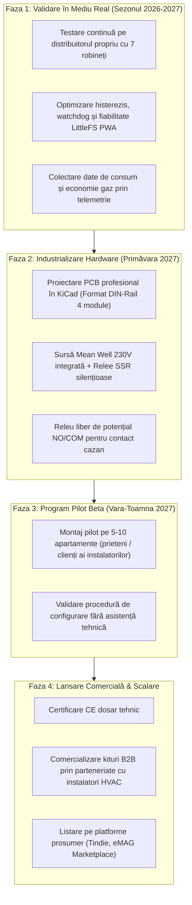

# Studiu de Piață, Analiză Competitivă, Unit Economics & Evaluare ROI

**Proiect:** Sistem Inteligent Autonom de Încălzire Multi-Zonă (Smart Home Heating)  
**Data elaborării:** 08 Octombrie 2026  
**Status document:** Document de analiză strategică & viabilitate comercială  
**Documente corelate:**
- Cerințe & Funcționalități: [`docs/requirements_and_features.md`](file:///c:/Users/BSeceleanu/.github_repos/smart-heating/docs/requirements_and_features.md)
- Evidență Piese & Costuri BOM: [`docs/bom_hardware_costs.md`](file:///c:/Users/BSeceleanu/.github_repos/smart-heating/docs/bom_hardware_costs.md)
- Schema & Specificații Hardware: [`docs/hardware_esp32_relay.md`](file:///c:/Users/BSeceleanu/.github_repos/smart-heating/docs/hardware_esp32_relay.md)
- Plan Activ de Dezvoltare: [`docs/plan.md`](file:///c:/Users/BSeceleanu/.github_repos/smart-heating/docs/plan.md)

---

## 1. Rezumat Executiv & Verdict de Marketabilitate

Acest document analizează oportunitatea comercială de a transforma controlerul termic autonom multi-zonă bazat pe **ESP32** dintr-un proiect rezidențial de tip DIY / Proof-of-Concept într-un produs comercial scalabil pe piața rezidențială din România și Europa Centrală și de Est.

### Verdict de Piață
* **Este marketabil?** **DA**, dar **NU** ca dispozitiv de larg consum destinat vânzării pe raftul magazinelor electrocasnice (retail de masă), ci ca **soluție integrată de retrofit pentru distribuitoare de încălzire în pardoseală**, comercializată fie direct către segmentul prosumer/smart home, fie în parteneriat B2B cu instalatori de instalații termice și sanitare.
* **Propunerea Unică de Valoare (Unique Value Proposition - UVP):**
  Un sistem autonom complet pentru 3–6 zone, cu interfață web locală PWA, senzori de cameră cu ecran LCD la cost de 20–25 RON, comandă radio/releu pentru centrală și **siguranță hidraulică industrială nativă**, livrat la **sub 30% din prețul sistemelor comerciale echivalente**, cu **zero dependență de cloud și zero abonamente**.

---

## 2. Segmente de Piață Țintă & Product-Market Fit (Unde se potrivește produsul)

### Segmentul A: Apartamente și Case Noi cu Încălzire în Pardoseală (Piața de Retrofit)
* **Contextul din teren:** În peste 80% din ansamblurile rezidențiale noi construite în marile orașe din România (București-Ilfov, Cluj, Timișoara, Iași, Brașov), dezvoltatorii montează încălzire în pardoseală cu distribuitor cu 5–10 circuite, însă lasă robineți manuali și instalează **un singur termostat On/Off pe hol sau în living**.
* **Punctul dureros (Pain Point):**
  - Dezechilibru termic cronic: când livingul atinge 22°C și oprește centrala, dormitorul orientat spre nord rămâne rece (19°C); dacă se crește temperatura din living, dormitorul devine confortabil, dar livingul se supraîncălzește la 24°C, irosind masiv gaz.
  - Cumpărarea unui kit comercial de brand (Salus, Danfoss, Honeywell) sperie cumpărătorul prin prețuri de 2.500 – 4.500 RON.
* **Fit-ul produsului:** Un modul montat discret direct în caseta metalică a distribuitorului, conectat la actuatoare electrotermice standard 230V M30x1.5, care citește wireless temperaturile din fiecare cameră și echilibrează hidraulic locuința.

### Segmentul B: Comunitatea Smart Home & Prosumeri Axati pe Securitate și Local Control
* **Punctul dureros:** Utilizatorii care refuză soluțiile dependente de cloud-uri chinezești (Tuya/SmartLife) sau abonamente lunare (Tado Auto-Assist). Aceștia cer funcționare offline garantată, latență zero și integrare ușoară cu Home Assistant, Node-RED sau MQTT.
* **Fit-ul produsului:** Firmware cu server web local, LittleFS PWA, API REST documentat, consolă Telnet/Web bidirecțională și operare garantată chiar dacă pică routerul Wi-Fi sau conexiunea WAN.

### Segmentul C: Instalatori Independenți HVAC & Echipe de Amenajări Interioare (Canal B2B)
* **Oportunitatea:** Instalatorii caută soluții cu marjă bună de manoperă pe care să le poată propune clienților lor ca upgrade valoros („Automatizare inteligentă multi-zonă la predarea apartamentului la cheie”).
* **Fit-ul produsului:** Un kit preconfigurat care se cablează în 15 minute în distribuitor, fără a necesita reconfigurări de rețea complicate sau conturi pe platforme terțe.

---

## 3. Analiză Competitivă (Cu cine se bate pe piață)

Piața soluțiilor de termostatare multi-zonă este polarizată între giganții industriali consacrați și soluțiile low-cost din ecosistemul Tuya.

### 3.1. Matrice Comparativă de Caracteristici & Preț

| Criteriu de Evaluare | Sistemul Nostru (Smart Heating ESP32) | Salus Controls (iT600 / Quantum) | Tado° Smart Multi-Zone | Honeywell Evohome Wi-Fi | Hub-uri Chinezești Tuya/BEOK |
|---|:---:|:---:|:---:|:---:|:---:|
| **Cost Sistem 3 Zone (7 circuite)** | **~550 RON (BOM)** / **~950 RON (Preț vânzare kit)** | ~2.650 – 3.200 RON | ~2.800 – 3.300 RON | ~3.800 – 4.600 RON | ~550 – 800 RON |
| **Dependență Cloud** | **ZERO (100% Local)** | Da (Salus Cloud) | Da (Tado Cloud) | Da (Total Connect Comfort) | Da (Tuya / SmartLife servers) |
| **Cost Termostat / Senzor Unitar** | **20 – 25 RON** (Xiaomi BLE LCD) | 220 – 320 RON (Salus SQ610) | 350 – 450 RON (Tado Wireless) | 380 – 480 RON (Round Wireless) | 90 – 150 RON (Tuya Zigbee/Wi-Fi) |
| **Interlock Hidraulic Actuatoare (120–180s)** | **DA (Nativ hardware & software)** | Da (în regletele KL08RF) | Parțial / Opțional software | Da (în modulele HCC80R) | **NU (Pornire instantanee, risc cavitație)** |
| **Pump Overrun (Răcire Schimbător)** | **DA (180s configurabil)** | Da | Limitat | Da | **NU** |
| **Abonament Lunar / Anual** | **Fără abonament** | Fără abonament | **DA (Auto-Assist ~150 RON/an)** | Fără abonament | Fără abonament |
| **Interfață Utilizator** | Schemă vectorială SVG personalizată a apartamentului + PWA | Aplicație generică mobil | Aplicație mobil foarte șlefuită | Consolă tactilă color + aplicație | Aplicație standard Tuya/SmartLife |
| **Comandă Centrală fără Fir** | RF 433.92 MHz reprodus fidel sau releu | Releu radio RX10RF dedicat | Modul radio de cazan inclus | Modul releu BDR91 | Releu cablat sau Zigbee |

### 3.2. Diferențiatori Cheie & Avantaje Competitive
1. **Costul Senzorilor de Cameră:** La Salus sau Tado, echiparea a 5 camere cu termostate de perete costă 1.200 – 2.000 RON doar senzorii. La soluția noastră, 5 senzori Xiaomi BLE LYWSD03MMC cu afișaj LCD și baterie de 2 ani costă cumulat ~100–125 RON.
2. **Siguranță Hidraulică Reală:** Actuatoarele termoelectrice pe bază de parafină/ceară au o inerție mecanică de 2.5–3.5 minute. Pornirea flăcării centralei înainte de deschiderea efectivă a circuitului forțează pompa de circulație împotriva dopului hidraulic. Sistemul nostru are interblocare software strictă (`DEFAULT_ACTUATOR_DELAY_MS = 120s`) și disipare a căldurii reziduale (`PUMP_OVERRUN_MS = 180s`).
3. **Imunitate la Probleme de Conectivitate:** Dacă providerul de internet pică sau routerul se restartează, algoritmul de reglaj termic continuă să ruleze pe ESP32 fără întrerupere.

---

## 4. Evaluare Financiară & Rentabilitate (ROI)

### 4.1. ROI pentru Cumpărătorul Final (Locatar / Proprietar)

* **Cost achiziție pachet complet:** ~850 – 1.050 RON (Controller + 4 senzori BLE + 7 actuatoare NC 230V).
* **Consum mediu de gaz pe sezon rece (apartament 3-4 camere, bloc izolat, România):**
  - Factură medie lunară (Noiembrie – Martie): ~600 – 850 RON/lună.
  - Cheltuială totală sezon rece (5 luni): ~3.000 – 4.000 RON.
* **Economie demonstrată prin zonare termică independentă:**
  - Reducerea temperaturii în camerele neocupate și dormitoare pe timpul zilei (de la 22.5°C la 19.5°C) aduce o economie medie documentată de **15% – 22%** la consumul de gaz metan.
  - Economie financiară anuală: **450 – 800 RON / sezon rece**.
* **Perioadă de amortizare a investiției (Payback Period):**
  $$\text{Payback Period} = \frac{\text{Cost Investiție (950 RON)}}{\text{Economie Anuală (650 RON)}} \approx \mathbf{1.4\text{ sezoane reci (\textasciitilde 7 luni de funcționare)}}.$$
  *(Sistemele Salus sau Honeywell necesită 4–6 sezoane pentru a se amortiza).*

---

### 4.2. Unit Economics & ROI pentru Afacere / Producător

Calcul bazat pe o serie pilot industrializată de **250 de unități**:

#### Cost de Producție Unitar (COGS - Cost of Goods Sold) pentru Controller:
| Subansamblu / Componentă | Furnizor / Metodă | Cost Unitar (RON) | Cost Unitar (EUR) |
|---|---|:---:|:---:|
| PCB Custom cu 4 Relee + ESP32-WROOM-32E (SMT montat automat) | JLCPCB / PCBWay | ~55.00 | ~11.00 € |
| Sursă de alimentare integrată AC/DC 230V $\rightarrow$ 5V (Mean Well / Hi-Link) | TME / Mouser | ~20.00 | ~4.00 € |
| Modul Transmisie Radio 433.92 MHz (SYN115) + bornă antenă SMA | Producție integrată | ~7.00 | ~1.40 € |
| Carcasă ignifugă montaj pe șină DIN (4 module, material ABS/PC) | Import distribuitor carcase | ~18.00 | ~3.60 € |
| Ambalaj carton, etichetă, ghid rapid de montaj imprimat | Tipografie locală | ~6.00 | ~1.20 € |
| **Subtotal Controller Distribuitor (Hardware + Ambalaj)** | — | **~106.00 RON** | **~21.20 €** |
| **Modul Receptor Universal Centrală** (ESP-NOW releu contact uscat NO/COM) | Modul nod cazan | ~30.00 | ~6.00 € |
| **TOTAL Cost Producție Sistem Complet (Controller + Receptor Cazan)** | — | **~136.00 RON** | **~27.20 €** |

#### Structură de Preț & Marje Comerciale:
* **Varianta 1: Vânzare Controller Individual + Modul Centrală (pentru pasionați DIY & Smart Home):**
  - Preț recomandat de vânzare: **399.00 RON** (TVA inclus) $\rightarrow$ ~335 RON net.
  - Marjă brută unitară: **~199 RON / pachet (~59% marjă brută)**.
* **Varianta 2: Kit Complet "Distribuitor Inteligent 3 Zone" (Controller + Modul Centrală + 4 Senzori BLE preconfigurați + 7 Actuatoare NC 230V):**
  - Cost total piese achiziționate: 136 lei (hardware centrală+distribuitor) + 90 lei (senzori) + 280 lei (actuatoare) = **~506 RON**.
  - Preț recomandat de vânzare kit complet: **1.099.00 RON** (TVA inclus) $\rightarrow$ ~923 RON net.
  - Marjă brută unitară: **~417 RON / kit vândut (~45% marjă brută)**.
* **Varianta 3: Pachet cu Instalare la Cheie (în parteneriat cu instalatori HVAC sau montaj propriu):**
  - Preț pachet cu manoperă: **1.450 – 1.650 RON**.
  - Marjă brută realizată: **~950 – 1.150 RON per montaj de 90 de minute**.

---

## 5. Bariere de Intrare, Riscuri Tehnice & Conformitate Legală

Trecerea de la stadiul de proiect funcțional pe masa de lucru la un produs comercial implică depășirea următoarelor obstacole:

### 1. Certificarea Europeană Obligatorie (Marcaj CE)
* Dispozitivul funcționează conectat direct la rețeaua de **230V AC** și utilizează emisie/recepție de radiofrecvență (**433.92 MHz, Wi-Fi 2.4 GHz, BLE**).
* Pentru a fi vândut legal în Uniunea Europeană, produsul trebuie să respecte:
  - **Directiva de Joasă Tensiune (LVD 2014/35/EU):** Izolație galvanică adecvată între circuitele de 230V și cele de 3.3V (distanțe de conturnare / creepage distance de minim 6 mm), teste de rigiditate dielectrică.
  - **Directiva Echipamente Radio (RED 2014/53/EU):** Emisii electromagnetice permise în banda ISM 433.92 MHz.
  - **Directiva Compatibilitate Electromagnetică (EMC 2014/30/EU):** Imunitate la paraziții generați la comutarea bobinelor releelor și emisiile de rețea.
* **Cost estimat testare laborator acreditat:** Între **3.500 și 7.000 EUR** pentru dosarul tehnic complet.

### 2. Răspundere Civilă și Siguranța Bunurilor
* În cazul în care o valvă se blochează din cauza unui bug software sau releu defect și îngheață o țeavă iarna (sau se supraîncălzește un circuit), producătorul poate fi tras la răspundere.
* Sunt obligatorii:
  - Watchdog hardware permanent activ pe ESP32.
  - Relee de calitate cu contacte garantate pentru sarcini inductive.
  - Circuit hardware failsafe (ex: siguranță termică fuzibilă și contacte NC care revin mecanic în poziție sigură).

### 3. Diversitatea Centralelor Termice din Piață & Problema Semnalului Radio
* În locuința proprie, comanda centralei a funcționat prin sniffing-ul protocolului radio OOK al termostatului existent.
* **Realitatea din teren:**
  1. *Fiecare producător/termostat are alt cod/ID de împerechere:* Chiar dacă frecvența e 433.92 MHz, trenul de impulsuri diferă pentru a nu aprinde centrala vecinului din bloc.
  2. *Multe centrale nu au modul wireless deloc:* Au doar un fir tras până în living sau o simplă punte/jumper pe contactul TA (Termostato Ambiente).
  3. *Unele termostate folosesc 868 MHz sau coduri săritoare (Rolling Code):* Imposibil de clonat prin simplu sniffing la client în sufragerie.
* **Soluția Tehnică Comercială adoptată:**
  - **Canalul Universal (Standard):** Kitul include obligatoriu un **Modul Receptor Universal de Centrală** (alimentat la 230V din priza centralei, cu releu contact uscat NO/COM legat pe borna TA a centralei). Comunică cu distribuitorul prin protocolul criptat **ESP-NOW** (cip-la-cip, 150m acoperire, zero dependență de Wi-Fi sau interferențe).
  - **Unealta de Teren "Heating Sniffer" (Opțional rapid):** O sculă portabilă de sniffing (ESP32 + SYN480R/CC1101 + ecran OLED) pentru cazurile unde clientul are deja receptor 433MHz compatibil. Se citește codul vechiului termostat în 3 secunde și se injectează în controller, evitând desfacerea centralei și economisind modulul fizic.

### 4. Pregătirea Senzorilor Xiaomi BLE
* Utilizatorul de rând nu știe și nu dorește să folosească Telink Flasher din browser pentru a rescrie firmware-ul BTHome v2 pe termometrele Xiaomi.
* Pentru un produs comercial, senzorii trebuie:
  - Fie livrați gata rescriși și pre-împerecheați în fabrică cu adresele MAC deja memorate în Flash-ul ESP32.
  - Fie înlocuiți cu un senzor BLE/Zigbee comercial standard cu protocol deschis din fabrică.

---

## 6. Foaie de Parcurs Strategică (Go-to-Market Roadmap)

---

## 7. Concluzii & Recomandare Strategică

1. **Valoarea reală a proiectului nu stă doar în cod sau circuite, ci în *cunoașterea hidraulică integrată*:** Algoritmii de întârziere la deschiderea actuatorului și disiparea căldurii reziduale rezolvă probleme pe care nici măcar unele kituri comerciale chinezești de 700 de lei nu le adresează corect.
2. **Cea mai eficientă cale de valorificare financiară:** Nu producția de serie de masă (care implică cheltuieli masive de capital și marketing împotriva unor companii precum Tado sau Honeywell), ci **modelul de afacere bazat pe soluții de instalare și retrofit la cheie (B2B2C)**:
   - Parteneriat cu 2–3 instalatori independenți de instalații termice.
   - Furnizarea sistemului ca "Kit de automatizare inteligentă de distribuitor" asamblat și testat profesional.
   - Fiecare lucrare aduce un profit brut de 400–600 RON pe echipament + marja de manoperă a instalatorului, amortizându-se complet pentru proprietar încă din prima iarnă.
