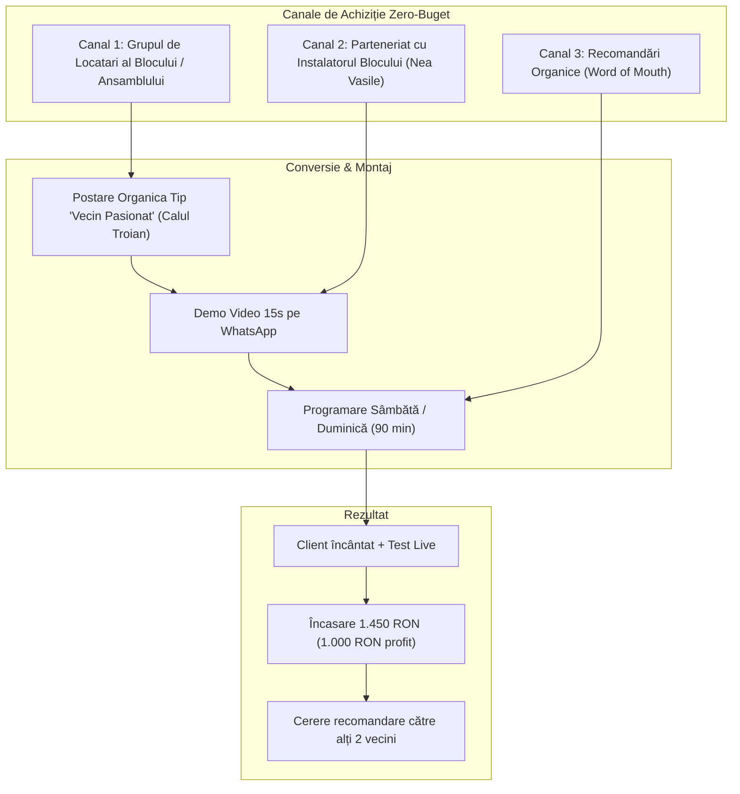

# Plan de Vânzări, Strategie Comercială & Registru TODO (Sales & Side-Hustle Playbook)

**Proiect:** Sistem Inteligent Autonom de Încălzire Multi-Zonă (Smart Home Heating)  
**Profil activitate:** Side-hustle tehnic de weekend (inginerie automotive $\rightarrow$ servicii rezidențiale premium la cheie)  
**Data elaborării:** 08 Octombrie 2026  
**Status:** Plan activ de acțiune & execuție  
**Documente corelate:**
- Studiu de Piață & Evaluare ROI: [`docs/market_analysis_and_roi.md`](file:///c:/Users/BSeceleanu/.github_repos/smart-heating/docs/market_analysis_and_roi.md)
- Evidență Costuri BOM: [`docs/bom_hardware_costs.md`](file:///c:/Users/BSeceleanu/.github_repos/smart-heating/docs/bom_hardware_costs.md)
- Cerințe de Sistem & Failsafe: [`docs/requirements_and_features.md`](file:///c:/Users/BSeceleanu/.github_repos/smart-heating/docs/requirements_and_features.md)
- Plan Tehnic: [`docs/plan.md`](file:///c:/Users/BSeceleanu/.github_repos/smart-heating/docs/plan.md)

---

## 1. Viziunea & Ținta Financiară a Side-Hustle-ului

### Obiectivul Cheie
Validarea produsului în piață și generarea unui venit net recurent de **~6.000 – 8.000 RON / lună** lucrând strict **2–3 weekenduri pe lună** (fără impact asupra jobului de zi din IT automotive).

### Formula de Venit:
* **Preț pachet la cheie per client:** **1.490 RON** (Piese + Modul Centrală + Montaj pe distribuitor + Configurare telefon).
* **Cost piese per lucrare (BOM):** **~450 – 480 RON** (Controller ESP32 + Modul Cazan ESP-NOW + 6 Actuatoare NC + 3 Senzori BLE + WAGO).
* **Profit brut per montaj:** **~1.010 – 1.040 RON**.
* **Timp alocat per montaj:** 30 minute pregătire acasă + 90 minute la client.
* **Cadenta:** 2 montări pe weekend $\times$ 4 weekenduri = **8 montări/lună** $\rightarrow$ **~8.200 RON profit net lunar**.

---

## 2. Oferta Comercială "La Cheie" (The Core Offer)

Clienții nu cumpără un microcontroler; ei cumpără **rezolvarea dezechilibrului termic și scăderea facturii la gaz fără bătăi de cap**.

### Pachetul Standard: *"Smart Heat Zone – Confort Perfect în Fiecare Cameră"*
1. **Creierul electronic de distribuitor:** Modulul autonom ESP32 montat discret în cutia distribuitorului de pardoseală.
2. **Modul Receptor Universal de Centrală (Inclus):** Mic modul wireless cu releu contact uscat (NO/COM) legat pe regleta TA a centralei, comunicând securizat prin **ESP-NOW** (sau semnal radio 433MHz clonat). Funcționează cu absolut orice centrală pe gaz.
3. **Actuatoare electrotermice 230V NC M30x1.5:** Instalate pe toți robineții distribuitorului (până la 6–7 circuite).
4. **Senzori digitali de cameră:** 3 termometre discrete cu afișaj LCD (Xiaomi BLE BTHome v2, autonomie baterie 2 ani).
5. **Montaj complet & cablare profesională:** Conectori rapizi WAGO 221, fără spart pereți, fără praf.
6. **Configurare aplicație locală PWA:** Instalată pe telefoanele familiei (interfață rapidă cu camerele casei).
7. **Garanție de Risc Inversat (30 de zile Confort Garantat):** Dacă în 30 de zile temperaturile nu sunt echilibrate cum dorește clientul, se demontează totul și se returnează 100% din bani.

### 2.1. Modelul de Venit Recurent: *"Smart Heat Fleet Care / Remote SLA"* (Abonament Cloud tip Tesla)
De ce să vindem doar o singură dată când putem asigura liniștea clientului și un venit pasiv lunar recurent?
- **Tarif:** **19 – 29 RON / lună** (sau 199 RON / an achitat integral la instalare).
- **Ce primește clientul:**
  1. **Acces de oriunde din afara casei:** Aplicația funcționează de la birou, din trafic sau din vacanță fără să fie nevoie de IP fix sau setări complicate pe routerul RDS/Digi/Vodafone.
  2. **Asistență la Distanță prin Telefon ("Tesla Service Mode"):** Dacă clientul are orice nelămurire („Mi se pare că dormitorul e cam rece azi”), inginerul se conectează la distanță pe modul, declanșează *Self-Test-ul*, citește codurile de eroare *DTC*, forțează acționarea actuatorului live și îi spune pe loc diagnosticul fără să se deplaseze („S-a terminat bateria la senzorul din dormitor, arată cod DTC-102, sau robinetul mecanic este gripat”).
  3. **Alerte Preventive Automate:** Clientul primește notificare pe WhatsApp înainte să se consume bateria la termometru sau dacă un actuator nu a deschis după 90 de minute de cerere de căldură.
  4. **Update-uri de Firmware Gratuite (OTA de acasă):** Algoritmi noi de optimizare și economisire a gazului împinși automat prin cloud.
- **Impact Financiar:**
  - 25 clienți activi = **~600 RON / lună venit pasiv garantat**.
  - 100 clienți activi = **~2.400 RON / lună** care acoperă cheltuielile lunare doar din câteva clicuri de suport telefonic!

---

## 3. Canale de Achiziție Clienți & Pâlnia de Conversie

### Canalul 1: „Calul Troian” pe Grupul de WhatsApp/Facebook al Blocului
* **Momentul ideal:** Zilele reci de toamnă/iarnă când încep discuțiile despre calorifere reci și facturi.
* **Șablon de mesaj (Copywriting de test):**
  > *„Salutare vecini! Știu că mulți dintre noi ne-am lovit de aceeași problemă cu încălzirea în pardoseală: un singur termostat în living oprește centrala și dormitoarele rămân reci, sau facem saună ca să fie bine la copii.*  
  > *Fiind inginer, am refuzat să dau 3.000+ lei pe sistemele Salus/Honeywell care cer și abonamente lunare, așa că mi-am automatizat distribuitorul cu actuatoare independente și senzori fără fir pentru fiecare cameră.*  
  > *Rezultatul: fix 21.5°C la copii, 20°C în dormitor și 22°C în living, iar centrala pornește doar când e nevoie. Bonus: consumul de gaz a scăzut vizibil.*  
  > *Dacă mai vrea cineva să-și rezolve distribuitorul fără spart pereți și la un preț corect, pot ajuta cu drag 1-2 vecini sâmbăta asta cu piesele și montajul la cheie. Lăsați-mi un mesaj în privat!”*

### Canalul 2: Parteneriatul cu Instalatorii Locali (B2B Recomandare)
* Instalatorii de instalații sanitare/termice din cartier urăsc electronica, Wi-Fi-ul și aplicațiile mobile, dar clienții le cer mereu soluții de reglaj pe camere.
* **Propunere comercială:** Pentru fiecare client direcționat unde se montează automatizarea, instalatorul primește un comision fix de **150 – 200 RON** cash fără să miște un deget.

---

## 4. Scripturi de Conversație & Tratarea Obiecțiilor

### Obiecția 1: *„De ce să nu cumpăr un kit Salus / Tado de pe eMAG?”*
* **Răspuns recomandat:**  
  *„Poți lua Salus, dar te costă peste 3.000 de lei doar echipamentele, senzorii lor de perete sunt 250 de lei bucata dacă mai vrei unul, iar la final tot trebuie să chemi un electrician să ți le lege. La pachetul meu ai totul inclus – actuatoare, senzori, controller și montaj garantat – la jumătate de preț. În plus, funcționează 100% local, fără abonamente anuale cum cere Tado și fără riscul să rămâi în frig dacă pică internetul.”*

### Obiecția 2: *„Afectează cumva garanția centralei termice?”*
* **Răspuns recomandat:**  
  *„Deloc. Noi nu intervenim în interiorul centralei și nu modificăm arzătorul. Lucrăm strict pe robineții distribuitorului de pardoseală și pe comanda standard de termostat pe care orice centrală o are prevăzută din fabrică.”*

### Obiecția 3: *„Dacă pică conexiunea Wi-Fi sau se ia curentul?”*
* **Răspuns recomandat:**  
  *„Sistemul e dezvoltat pe standarde industriale: creierul rulează autonom în cutia distribuitorului. Dacă routerul se oprește, căldura continuă să funcționeze fără întrerupere. Iar la revenirea curentului, sistemul repornește automat în mod de siguranță în mai puțin de 5 secunde.”*

### Obiecția 4: *„Centrala mea e alt model sau nu are termostat fără fir. Cum o comandați?”*
* **Răspuns recomandat:**  
  *„Pachetul nostru include un mic modul receptor universal wireless pe care îl legăm direct pe borna standard de termostat (TA) a centralei. Comunică direct cip-la-cip cu distribuitorul prin protocol securizat, fără să interfereze cu vecinii din bloc și fără să depindă de router. Iar dacă aveți deja un termostat radio funcțional, avem un scaner portabil care îi clonează codul în 10 secunde, fără să fie nevoie să desfacem centrala deloc.”*

---

## 5. Procedură Standard de Montaj în 90 de Minute (SOP)

Pentru a maximiza profitul orar, munca se împarte strict:

### Faza A: Pregătire în avans acasă (25–30 minute)
- [ ] Flashuire firmware ESP32 cu setările de bază.
- [ ] Împerechere și etichetare senzori Xiaomi BLE (`Living`, `Copil`, `Dormitor`).
- [ ] Pregătire modul receptor cazan ESP-NOW (cu releu NO/COM testat).
- [ ] Încărcare sculă portabilă **Heating Sniffer** (baterie 18650 la 100%).
- [ ] Pregătire cablaj scurt și cleme WAGO 221 gata sertizate în carcasă.
- [ ] Verificare kit actuatoare (M30x1.5 NC 230V).

### Faza B: Intervenția la client (60–90 minute)
- [ ] **Min 0–15:** Deșurubare capace manuale distribuitor și înșurubare cele 6–7 actuatoare electrotermice (strângere ușoară la mână).
- [ ] **Min 15–35:** Cablarea fazelor actuatoarelor în releele corespondente prin conectori WAGO.
- [ ] **Min 35–45:** Alimentare placă la 230V și verificare deschidere actuator pe test manual.
- [ ] **Min 45–60 (Comandă Centrală - Dual Option):**
  - *Opțiunea A (Are termostat radio existent):* Pornești scula **Heating Sniffer**, apeși butonul vechiului termostat, capturezi trenul de impulsuri în 5 secunde și îl transmiți în controller prin Wi-Fi/ESP-NOW.
  - *Opțiunea B (Are cablu sau fără termostat):* Montezi cutiuța **Modulului Universal ESP-NOW** lângă centrală, conectezi releul pe borna TA (contact uscat) și alimentezi modulul din priza centralei (10 minute).
- [ ] **Min 60–75:** Amplasare termometre pe pereții camerelor (cu bandă dublu adezivă inclusă).
- [ ] **Min 75–85 (Setup Wizard & Pașaport Digital):**
  - Deschizi de pe telefon adresa `http://192.168.1.X/setup` (Asistentul Vizual de Montaj).
  - Senzorii BLE proaspăt despachetați sunt detectați automat în aer: cel ținut în mână are cel mai puternic semnal (RSSI -45 dBm).
  - Apeși *"Asociază la Zona 1 (Living)"*, *"Zona 2 (Copii)"*, *"Zona 3 (Dormitor)"*. Maparea se salvează instantaneu în memoria flash NVS.
  - Completezi câmpurile din **Pașaportul Digital de Montaj**: Nume Client, Adresă, model centrală și notițe tehnice. Ceasul se sincronizează prin NTP pe Wi-Fi și înregistrează data/ora de instalare.
  - Instalezi scurtătura PWA pe telefonul clientului și instruire scurtă de utilizare (3 minute).
- [ ] **Min 85–90:** Test live de pornire comandă centrală și recepție plată.

---

## 6. Registru Activ de Sarcini (TODO Checklist de Lansare)

### Etapa 1: Pregătire, Social Proof & Scule de Teren (Săptămâna 1)
- [ ] **TODO-1.1:** Finalizează montajul complet al celor 7 actuatoare pe distribuitorul propriu de acasă.
- [ ] **TODO-1.2:** Fă o poză profesională „Înainte și După” cu distribuitorul (curat, cablat cu WAGO, etichetat).
- [ ] **TODO-1.3:** Înregistrează un video scurt de 20 de secunde pe telefon: arăți cum schimbi temperatura din living pe aplicație și cum se aprinde comanda pe distribuitor.
- [ ] **TODO-1.4:** Pregătește o carcasă compactă din plastic (sau printată 3D) pentru a nu lăsa placa expusă la client.
- [ ] **TODO-1.5 (CRITIC - Scule & Modul Cazan):**
  - Construiește scula portabilă **"Heating Sniffer"** (ESP32 + modul SYN480R/CC1101 + ecran OLED 0.96" I2C) cu firmware de capture al trenurilor de impulsuri OOK și transmitere către controller.
  - Asamblează și testează 1 buc. **Modul Receptor Universal Centrală** bazat pe ESP-NOW (ESP-01S Relay sau ESP32-C3 SuperMini) cu releu contact uscat liber de potențial NO/COM.

### Etapa 2: Lansare Pilot & Primii 3 Clienți (Săptămâna 2)
- [ ] **TODO-2.1:** Postează mesajul de test pe grupul de WhatsApp/Facebook al blocului/ansamblului tău rezidențial.
- [ ] **TODO-2.2:** Răspunde în privat primilor doritori și programează o vizită de 10 minute pentru a verifica modelul distribuitorului (filet M30x1.5, priză disponibilă și tipul comenzii de centrală).
- [ ] **TODO-2.3:** Comandă piesele pentru primele 2 lucrări (actuatoare eMAG/Mathaus + senzori + modul releu cazan).
- [ ] **TODO-2.4:** Execută primul montaj într-o sâmbătă dimineață și cere feedback sincer după 48 de ore.
- [ ] **TODO-2.5:** Cere o recenzie scrisă pe WhatsApp de la primul client mulțumit („Social Proof”).

### Etapa 3: Relația cu Instalatorii & Scalare (Săptămânile 3–4)
- [ ] **TODO-3.1:** Identifică instalatorul care se ocupă de mentenanța complexului sau a blocurilor vecine.
- [ ] **TODO-3.2:** Invită instalatorul la o cafea / discuție de 10 minute și prezintă-i sistemul montat la tine acasă.
- [ ] **TODO-3.3:** Stabilește înțelegerea de comision (150–200 lei per client adus).
- [ ] **TODO-3.4:** Creează un pliant A5 simplu sau carte de vizită digitală pentru instalator.

### Etapa 4: Optimizare Hardware & Stoc Tampon (Luna 2)
- [ ] **TODO-4.1:** Creează un stoc tampon mic de piese (2 controllere gata asamblate + 2 module cazan ESP-NOW + 12 actuatoare + 6 senzori) pentru livrare imediată în 24h.
- [ ] **TODO-4.2:** Evaluează trecerea la o carcasă pe șină DIN industrială pentru un aspect 100% profesional.
- [ ] **TODO-4.3:** Calculează profitul net după primele 5 montări și decide dacă extinzi promovarea în complexele vecine.
