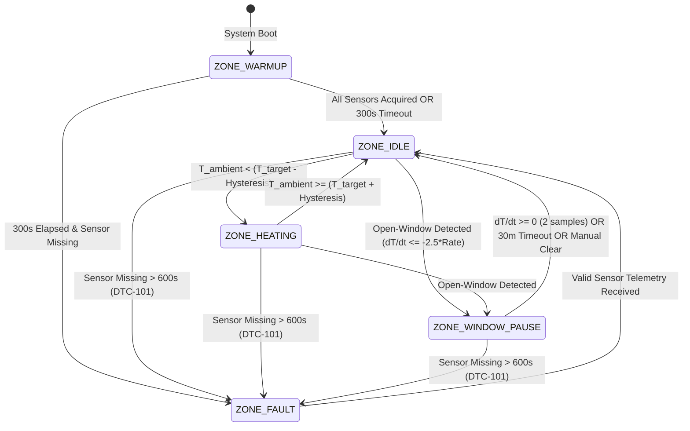

# [SWE.3] Detailed Software Unit Design & Interface Contracts

> **Standard:** ASPICE 4.0 PAM — Process SWE.3 (Software Detailed Design and Unit Construction)  
> **Status:** RELEASED / BASELINED  
> **Traceability:** Implements `[SWE-REQ-001]` through `[SWE-REQ-021]`  
> **Condition Adherence:** Complies with Independent Quality Audit Condition **[🔴CRT-03]**

---

# PART A: Detailed Unit Design (Internal Logic & Algorithms)

## 1. Thermal Zone Finite State Machine (FSM)

The control logic of each hydronic zone in `ThermalZoneManager` is governed by a deterministic 5-state Mealy/Moore hybrid state machine:



### 1.1 FSM State Descriptions & Transition Guard Invariants

| State | Entry Action | Periodic Action in `update()` | Exit Action |
|:---|:---|:---|:---|
| **`ZONE_WARMUP`** | Relay OFF (0V), start $300\text{ s}$ boot timer. | Check sensor acquisition counter. If all assigned sensors reported, exit immediately. | Log `[SCANNING COMPLETE - ALL ACQUIRED]`. |
| **`ZONE_IDLE`** | Relay OFF (0V), cancel zone boiler demand. | Evaluate hysteresis: if $T < T_{\text{eff}} - \text{Hyst}$, request transition to `ZONE_HEATING`. | Start actuator opening interlock timer ($120\text{ s}$). |
| **`ZONE_HEATING`** | Relay ON (230V to wax actuator). | Assert zone demand. If interlock elapsed and burner not locked by anti-short-cycling, trigger RF flame ON. | De-energize relay; start $180\text{ s}$ pump overrun. |
| **`ZONE_WINDOW_PAUSE`** | Relay OFF (0V), cancel boiler demand, raise badge. | Check for thermal rebound ($dT/dt \ge 0$) or safety timeout ($1800\text{ s}$). | Clear window open flag; resume standard control. |
| **`ZONE_FAULT`** | Relay OFF (0V), cancel boiler demand, raise `DTC-101`. | Monitor BLE scanner for packet arrival with matching MAC. | Clear `DTC-101` code; restore operational state. |

---

## 2. 12-Sample Circular FIFO Buffer & Derivative Estimators

Fulfilling **[SWE-REQ-018]** and **[SWE-REQ-019]**, `ThermodynamicEngine` implements a fixed-size, zero-heap circular buffer storing the last 60 minutes of temperature history sampled at 5-minute intervals:

```
Index:    0      1      2      3      4      5      6      7      8      9     10     11
Buffer: [ T_0 ][ T_1 ][ T_2 ][ T_3 ][ T_4 ][ T_5 ][ T_6 ][ T_7 ][ T_8 ][ T_9 ][T_10 ][T_11 ]
                                              ^
                                         head pointer (moves modulo 12)
```

### 2.1 Numerical Derivative Estimators
Every 5 minutes, when sample $T_k$ is pushed into the circular buffer:
1. **Central-Difference First Derivative ($dT/dt$):**
   $$\left(\frac{dT}{dt}\right)_k = \frac{T_k - T_{k-2}}{2 \cdot \Delta t} \quad \left[\frac{^\circ\text{C}}{\text{hour}}\right]$$
   where $\Delta t = \frac{5}{60} = 0.0833\text{ h}$.
2. **Second Derivative Acceleration ($d^2T/dt^2$):**
   $$\left(\frac{d^2T}{dt^2}\right)_k = \frac{T_k - 2T_{k-1} + T_{k-2}}{\Delta t^2} \quad \left[\frac{^\circ\text{C}}{\text{hour}^2}\right]$$
3. **Dynamic Threshold Evaluation:**
   $$\text{Threshold} = 2.5 \times k_{\text{loss}} \cdot (T_{\text{ambient}} - T_{\text{ext}})$$
   If $\left|\frac{dT}{dt}\right| > \text{Threshold}$ and $\frac{d^2T}{dt^2} < 0$, declare window open immediately.

---

# PART B: External Interface Contracts (REST API & LittleFS)

## 3. REST / JSON API Specification

All endpoints return HTTP status codes, use header `Content-Type: application/json`, and implement CORS `Access-Control-Allow-Origin: *`.

### 3.1 Boiler & System Control Endpoints

| Method | URI Path | Request Payload | Response Attributes | Description |
|:---:|:---|:---|:---|:---|
| `GET` | `/api/boiler/status` | *None* | `firmwareVersion`, `uptimeSec`, `boiler`, `freeHeap`, `otaFreeBytes`, `sensors[]` | Complete system telemetry snapshot. |
| `POST` | `/api/boiler/on` | `?force=true` (optional) | `success`, `boiler: "ON"`, `flameState` | Manual flame ignition command. |
| `POST` | `/api/boiler/off` | *None* | `success`, `boiler: "OFF"` | Manual flame extinction command. |
| `POST` | `/api/boiler/cancel` | *None* | `cancelled: true` | Cancels pending burner action in cooldown. |

### 3.2 Zone & Thermodynamic Calibration Endpoints

| Method | URI Path | Request Payload | Response Attributes | Description |
|:---:|:---|:---|:---|:---|
| `GET` | `/api/zones` | *None* | `zones[]`: `id`, `name`, `currentTemp`, `targetTemp`, `floorType`, `screedThicknessCm`, `tDeadMin`, `coolingSlope`, `preheatLeadMin`, `windowOpen` | Multi-zone telemetry & calibrated parameters. |
| `POST` | `/api/zones/setpoint` | `{"id": 1, "target": 22.5}` | `success: true`, `id`, `newTarget` | Sets zone setpoint temperature. |
| `POST` | `/api/zones/calibration` | `{"id": 1, "floorType": "tiles", "screedThicknessCm": 6.0, "insulation": "medium"}` | `success: true`, `tDeadMin`, `coolingSlope` | Updates floor construction calibration in NVS. |
| `POST` | `/api/zones/window/clear`| `{"id": 1}` | `success: true`, `windowOpen: false` | Manually dismisses open-window pause. |
| `POST` | `/api/schedule/away` | `{"away": true, "durationHours": 4}` | `success: true`, `awayActive: true` | Engages Away/Eco mode with auto-restore. |

### 3.3 Diagnostic & Service Endpoints

| Method | URI Path | Request Payload | Response Attributes | Description |
|:---:|:---|:---|:---|:---|
| `GET` | `/api/diag/status` | *None* | `dtcCodes[]`, `healthScore`, `selfTestPassed` | Active DTC register & diagnostics. |
| `POST` | `/api/diag/clear` | *None* | `cleared: true` | Clears latching DTC trouble codes. |
| `POST` | `/api/diag/exercise` | *None* | `exercising: true`, `durationSec: 20` | Triggers manual 20s anti-seize cycle. |
| `GET` | `/api/history/events` | *None* | `events[]`: `epoch`, `entity`, `state` | Second-accurate relay event log. |

### 3.4 LittleFS File Management Endpoint
- **URI:** `POST /api/upload-file` (Multipart form-data)
- **Role:** Directly streams compressed web assets (`index.html.gz`, `setup.html.gz`, icons) into the LittleFS filesystem partition without reflashing firmware binary or rebooting the ESP32.
