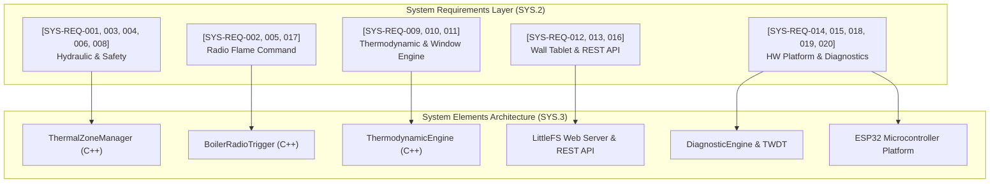

# [SYS.2] System Requirements Specification

> **Standard:** ASPICE 4.0 PAM — Process SYS.2 (System Requirements Analysis)  
> **System Name:** Autonomous Multi-Zone Hydronic Heating & Dynamic Thermodynamic Controller  
> **Status:** RELEASED / BASELINED  
> **Traceability Root:** `[SYS-REQ-xxx]`

---

## 1. Operational Design Domain (ODD)

The system operates in a residential hydronic underfloor heating environment with distributed wireless thermal sensing and radio frequency boiler actuation.

### 1.1 Climatic & Environmental Domain
- **Indoor Ambient Temperature Range:** $+5.0^\circ\text{C}$ to $+35.0^\circ\text{C}$ (measurement accuracy $\pm 0.2^\circ\text{C}$, resolution $0.01^\circ\text{C}$).
- **Indoor Relative Humidity Range:** $10\%$ to $95\%$ non-condensing (accuracy $\pm 2\%$).
- **Outdoor Ambient Temperature Range:** $-25.0^\circ\text{C}$ to $+40.0^\circ\text{C}$ (via Open-Meteo REST API or external 433.92 MHz meteorological station).
- **Physical Installation Envelope:** Indoor manifold metal cabinet with DIN rail or wall mount.

### 1.2 Communication Domain
- **Hydronic Actuator Bus:** 230V AC / 24V DC normally closed (NC) electrothermal wax actuators.
- **RF Boiler Telecommand Link:** 433.92 MHz On-Off Keying (OOK) radio broadcast (range $\ge 15\text{ m}$ through standard residential concrete/brick walls).
- **Wireless Sensor Ingestion:** Bluetooth Low Energy (BLE 5.0) passive broadcast scanner operating on $2.4\text{ GHz}$ ISM band (BTHome v2 format).
- **Local Network & Maintenance Interface:** IEEE 802.11 b/g/n Wi-Fi ($2.4\text{ GHz}$), static IPv4 lease on local subnet (`192.168.1.20`).

---

## 2. System Requirements Register

| Requirement ID | Title | Description & Verification Criteria | Safety / Integrity Level |
|:---|:---|:---|:---:|
| **[SYS-REQ-001]** | Multi-Zone Floor Loop Actuation | The system shall independently actuate at least 3 discrete underfloor heating zones using electrothermal wax actuators.  • *Verification:* Actuator relay states correlate 100% with zone demand. | ASIL-A / Safety Guarded |
| **[SYS-REQ-002]** | Boiler Flame Radio Trigger | The system shall command boiler ignition and extinction via an authentic 433.92 MHz OOK pulse train matching the receiver protocol without mechanical relay clicks on the boiler interface.  • *Verification:* Boiler ignites within 3s of transmission; flame status verified via current/acoustics. | ASIL-B / Critical Safety |
| **[SYS-REQ-003]** | Actuator Interlock Delay | The system shall delay boiler flame ignition by $120\text{ s}$ to $180\text{ s}$ following any zone call for heat, permitting wax actuators to achieve $\ge 80\%$ mechanical stroke.  • *Verification:* Zero boiler ignition before $t_{\text{interlock}}$ elapses. | ASIL-B / Hydronic Safety |
| **[SYS-REQ-004]** | Circulation Pump Overrun | Following boiler burner shutdown, secondary circulation pump shall maintain forced flow for $180\text{ s}$ through an open hydraulic path to dissipate residual heat exchanger energy.  • *Verification:* Pump stays engaged for $180\text{ s} \pm 2\text{ s}$ post-flame OFF. | ASIL-B / Boiler Safety |
| **[SYS-REQ-005]** | Anti-Short-Cycling Burner Guard | The system shall enforce a minimum continuous burner run time of $60\text{ s}$ and a minimum burner rest time of $60\text{ s}$ between consecutive firings to prevent thermal stress and component wear.  • *Verification:* Rapid state toggles rejected with HTTP 429 and cooldown timer. | ASIL-A / Reliability |
| **[SYS-REQ-006]** | Emergency Freeze Protection | The system shall force zone valve opening and boiler heating if any active zone temperature drops below $+12.0^\circ\text{C}$, overriding all manual OFF and schedule settings.  • *Verification:* Automated engagement when $T_{\text{zone}} < 12.0^\circ\text{C}$. | ASIL-B / Property Safety |
| **[SYS-REQ-007]** | Sensor Offline Isolation (DTC-101) | If an assigned BLE room sensor fails to deliver telemetry for $> 600\text{ s}$ (10 minutes), the system shall isolate that zone (close actuator) to prevent thermal runaway and raise `DTC-101`.  • *Verification:* Zone closes, error code logged, recovery is automatic on telemetry resumption. | ASIL-A / Failsafe |
| **[SYS-REQ-008]** | Weekly Anti-Seize Exercise Cycle | During prolonged idle periods (summer mode), the system shall cycle all actuators and pump for $20\text{ s}$ once every 7 days to prevent mechanical limescale binding.  • *Verification:* Verified via NVS timestamp and manual trigger API `/api/diag/exercise`. | Serviceability |
| **[SYS-REQ-009]** | Autonomous 2R2C Model Calibration | The system shall autonomously estimate building thermal loss rate ($k_{\text{loss}}$) and floor slab response metrics ($t_{\text{dead}}$, $dT/dt$, $\Delta T_{\text{overshoot}}$) without cloud dependencies.  • *Verification:* Parameter convergence error $\le 3.0\%$ on nominal 2R2C simulation. | Thermodynamic Performance |
| **[SYS-REQ-010]** | Predictive Pre-Heating Lead Time | The system shall dynamically compute pre-heat lead time so that indoor temperature reaches target setpoint within $\pm 0.3^\circ\text{C}$ of the scheduled arrival anchor.  • *Verification:* Arrival error $\le 0.3^\circ\text{C}$ across tile and parquet screeds. | Energy & Comfort |
| **[SYS-REQ-011]** | Rapid Derivative Open-Window Detection | The system shall declare a window open event within $\le 15\text{ min}$ during mild weather ($T_{\text{ext}} = 15^\circ\text{C}$) and within $\le 5\text{ min}$ in cold weather ($T_{\text{ext}} \le 0^\circ\text{C}$) based on rate-of-change thresholds.  • *Verification:* Actuator de-energized, zero false triggers over 6h baseline noise. | Energy Saving |
| **[SYS-REQ-012]** | Wall-Tablet Touch Dashboard (Zero-Scroll) | The local web dashboard shall render responsively on a $1280 \times 800$ landscape tablet (Galaxy Tab A9) with zero vertical scroll requirement (viewport height $\le 530\text{px}$).  • *Verification:* Chrome DevTools viewport layout audit pass. | Ergonomics / HMI |
| **[SYS-REQ-013]** | Sub-100ms Headless REST API | All REST JSON endpoints (`GET /api/boiler/status`, `GET /api/zones`, `POST /api/zones/setpoint`) shall respond within $\le 100\text{ ms}$ under local Wi-Fi.  • *Verification:* 95th percentile latency $\le 100\text{ ms}$ across 100 requests. | Performance |
| **[SYS-REQ-014]** | Non-Volatile Flash Wear Protection | Calibration and configuration values stored in NVS flash shall only be committed when value delta exceeds $\pm 2\%$, preventing flash wear exhaustion.  • *Verification:* Repeated redundant writes produce 0 NVS write cycles. | Durability |
| **[SYS-REQ-015]** | Firmware Memory Budget & OTA Limit | The compiled firmware binary shall not exceed the $1.25\text{ MB}$ ($1,310,720\text{ bytes}$) OTA application partition slot, maintaining free heap $\ge 80\text{ KB}$.  • *Verification:* Binar size $\le 1.25\text{ MB}$, heap verified via `GET /api/boiler/status`. | Embedded Integrity |
| **[SYS-REQ-016]** | Web Asset Decoupling (LittleFS) | Web UI assets (`index.html.gz`, icons) shall be stored and served from the LittleFS partition, permitting UI evolution without flashing firmware binary.  • *Verification:* `tools/upload_ui.py` updates UI in $< 1\text{ s}$ without ESP32 reboot. | Modularity |
| **[SYS-REQ-017]** | Power-Loss Safety State Recovery | Following unexpected electrical power loss, the system shall safely reboot, read NVS presets, issue an RF flame OFF burst, and synchronize time via NTP within $15\text{ s}$.  • *Verification:* Power interruption test verifies flame OFF signal on boot. | Safety Invariant |
| **[SYS-REQ-018]** | Hardware Task Watchdog (ESP32 TWDT) | The system shall employ a hardware Task Watchdog Timer calibrated to $30\text{ s}$. If `loop()` stalls for $> 30\text{ s}$, a hardware panic reboot shall be triggered.  • *Verification:* Induced infinite loop triggers TWDT reboot within $30\text{ s}$. | Fault Tolerance |
| **[SYS-REQ-019]** | Diagnostic Trouble Code (DTC) Registry | The system shall maintain an active diagnostic trouble code registry (`DTC-101` to `DTC-402`) reporting sensor faults, actuator failures, Wi-Fi drops, and short-cycle warnings.  • *Verification:* Verified via `/api/diag/status`. | Serviceability |
| **[SYS-REQ-020]** | Outbound Reverse Cloud Telemetry | The system shall establish an outbound MQTT or reverse HTTP tunnel for remote fleet monitoring without requiring customer router port-forwarding or public IP.  • *Verification:* Remote status fetch verified via tunnel endpoint. | Scalability |

---

## 3. Requirements Allocation to System Elements

